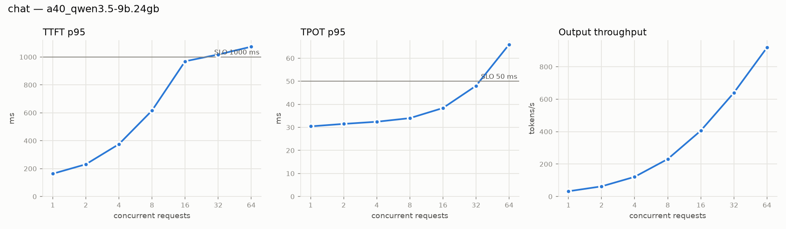
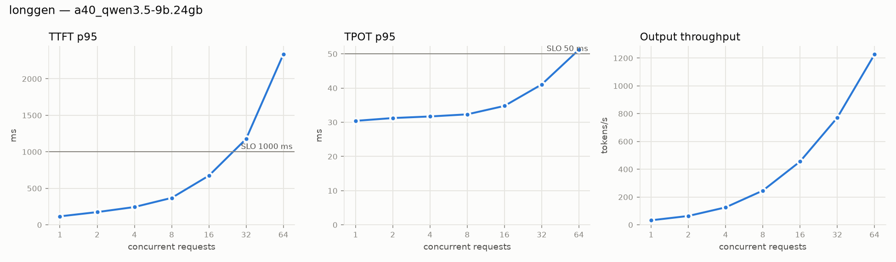
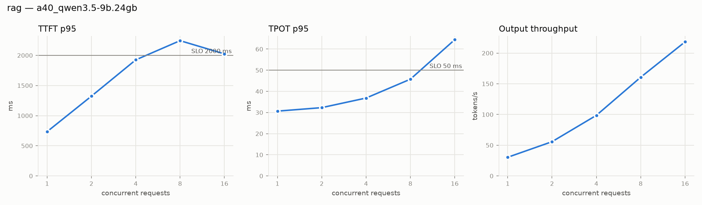

# Benchmark report — a40_qwen3.5-9b.24gb

- **GPU:** NVIDIA A40 · driver 595.112.07 · PCIe gen4 x16
- **Provider / price:** runpod · $0.59/h
- **Server:** http://127.0.0.1:8000 · model `Qwen/Qwen3.5-9B` · vLLM 0.32.0
- **Methodology:** 1.1 · loadgen 0.1.0 · repo 368de4ad6a
- **Prompt calibration:** 1.000 tokens/word (tokenize)
- **Run:** 2026-11-25T14:38:03.959Z → 2026-11-25T16:25:40.366Z

## chat

512 → 256 tokens. SLO: TTFT p95 ≤ 1000 ms, TPOT p95 ≤ 50 ms, errors < 0.5%.

**Closed loop**

| Load | n | Errors | TTFT p50 / p95 / p99 (ms) | TPOT p50 / p95 (ms) | ITL p99 (ms) | Output tok/s | Req/s | Goodput req/s | SLO | Notes |
|---|---:|---:|---|---|---:|---:|---:|---:|:-:|---|
| c=1 | 30 | 0.0% | 142 / 163 / – | 30.4 / 30.4 | 32.2 | 32 | 0.13 | 0.13 | ✓ | p99 n/a (n=30) |
| c=2 | 31 | 0.0% | 187 / 231 / – | 31.3 / 31.5 | 34.0 | 63 | 0.24 | 0.24 | ✓ | p99 n/a (n=31) |
| c=4 | 44 | 0.0% | 354 / 375 / – | 31.7 / 32.4 | 34.2 | 121 | 0.51 | 0.51 | ✓ | p99 n/a (n=44) |
| c=8 | 85 | 0.0% | 509 / 616 / – | 32.7 / 34.0 | 41.2 | 231 | 0.95 | 0.95 | ✓ | p99 n/a (n=85) |
| c=16 | 141 | 0.0% | 733 / 969 / – | 36.4 / 38.4 | 197.9 | 406 | 1.75 | 1.73 | ✓ | p99 n/a (n=141) |
| c=32 | 237 | 0.0% | 765 / 1,018 / – | 46.6 / 48.0 | 256.6 | 640 | 2.64 | 2.26 | ✗ | p99 n/a (n=237) |
| c=64 | 357 | 0.0% | 812 / 1,074 / 1,093 | 64.8 / 66.0 | 273.9 | 918 | 3.96 | 0.13 | ✗ |  |

**Open loop (Poisson)**

| Load | n | Errors | TTFT p50 / p95 / p99 (ms) | TPOT p50 / p95 (ms) | ITL p99 (ms) | Output tok/s | Req/s | Goodput req/s | SLO | Notes |
|---|---:|---:|---|---|---:|---:|---:|---:|:-:|---|
| 0.87 req/s | 72 | 0.0% | 171 / 218 / – | 34.2 / 36.3 | 96.1 | 205 | 0.84 | 0.84 | ✓ | p99 n/a (n=72) |
| 1.741 req/s | 183 | 0.0% | 196 / 279 / – | 44.6 / 47.1 | 104.8 | 515 | 2.06 | 2.06 | ✓ | p99 n/a (n=183) |
| 2.611 req/s | 227 | 0.0% | 214 / 346 / – | 50.8 / 53.0 | 120.1 | 664 | 2.63 | 0.82 | ✗ | p99 n/a (n=227) |
| 3.133 req/s | 300 | 0.0% | 243 / 387 / 461 | 63.9 / 72.1 | 192.9 | 864 | 3.45 | 0.28 | ✗ |  |

- **Capacity (concurrency):** 16 concurrent requests · 406 output tok/s · $0.404 per 1M output tokens · $0.130 per 1M total tokens
- **Capacity (rate):** 1.74 req/s · 515 output tok/s · $0.318 per 1M output tokens · $0.104 per 1M total tokens

## longgen

200 → 1000 tokens. SLO: TTFT p95 ≤ 1000 ms, TPOT p95 ≤ 50 ms, errors < 0.5%.

**Closed loop**

| Load | n | Errors | TTFT p50 / p95 / p99 (ms) | TPOT p50 / p95 (ms) | ITL p99 (ms) | Output tok/s | Req/s | Goodput req/s | SLO | Notes |
|---|---:|---:|---|---|---:|---:|---:|---:|:-:|---|
| c=1 | 30 | 0.0% | 108 / 116 / – | 30.4 / 30.4 | 32.1 | 33 | 0.03 | 0.03 | ✓ | p99 n/a (n=30) |
| c=2 | 31 | 0.0% | 147 / 175 / – | 31.2 / 31.2 | 33.2 | 64 | 0.06 | 0.06 | ✓ | p99 n/a (n=31) |
| c=4 | 33 | 0.0% | 196 / 244 / – | 31.7 / 31.7 | 34.4 | 126 | 0.13 | 0.13 | ✓ | p99 n/a (n=33) |
| c=8 | 37 | 0.0% | 314 / 369 / – | 32.2 / 32.3 | 36.0 | 246 | 0.28 | 0.28 | ✓ | p99 n/a (n=37) |
| c=16 | 48 | 0.0% | 519 / 674 / – | 34.6 / 34.8 | 39.4 | 455 | 0.68 | 0.68 | ✓ | p99 n/a (n=48) |
| c=32 | 96 | 0.0% | 840 / 1,177 / – | 40.6 / 41.1 | 47.7 | 771 | 1.15 | 0.77 | ✗ | p99 n/a (n=96) |
| c=64 | 128 | 0.0% | 1,525 / 2,336 / – | 50.4 / 51.2 | 62.6 | 1,226 | 2.44 | 0.00 | ✗ | p99 n/a (n=128) |

**Open loop (Poisson)**

| Load | n | Errors | TTFT p50 / p95 / p99 (ms) | TPOT p50 / p95 (ms) | ITL p99 (ms) | Output tok/s | Req/s | Goodput req/s | SLO | Notes |
|---|---:|---:|---|---|---:|---:|---:|---:|:-:|---|
| 0.307 req/s | 29 | 0.0% | 129 / 143 / – | 33.5 / 34.2 | 56.8 | 319 | 0.28 | 0.28 | ✓ | p99 n/a (n=29) |
| 0.614 req/s | 71 | 0.0% | 159 / 186 / – | 42.6 / 42.8 | 84.4 | 805 | 0.71 | 0.71 | ✓ | p99 n/a (n=71) |
| 0.921 req/s | 87 | 0.0% | 166 / 202 / – | 44.4 / 46.0 | 93.4 | 907 | 0.79 | 0.79 | ✓ | p99 n/a (n=87) |
| 1.105 req/s | 82 | 0.0% | 160 / 203 / – | 43.6 / 44.0 | 85.8 | 866 | 0.74 | 0.74 | ✓ | p99 n/a (n=82) |

- **Capacity (concurrency):** 16 concurrent requests · 455 output tok/s · $0.360 per 1M output tokens · $0.295 per 1M total tokens
- **Capacity (rate):** 1.10 req/s · 866 output tok/s · $0.189 per 1M output tokens · $0.154 per 1M total tokens

## rag

4000 → 300 tokens. SLO: TTFT p95 ≤ 2000 ms, TPOT p95 ≤ 50 ms, errors < 0.5%.

**Closed loop**

| Load | n | Errors | TTFT p50 / p95 / p99 (ms) | TPOT p50 / p95 (ms) | ITL p99 (ms) | Output tok/s | Req/s | Goodput req/s | SLO | Notes |
|---|---:|---:|---|---|---:|---:|---:|---:|:-:|---|
| c=1 | 30 | 0.0% | 716 / 734 / – | 30.6 / 30.7 | 32.4 | 30 | 0.10 | 0.10 | ✓ | p99 n/a (n=30) |
| c=2 | 31 | 0.0% | 1,127 / 1,323 / – | 31.8 / 32.3 | 34.1 | 56 | 0.19 | 0.19 | ✓ | p99 n/a (n=31) |
| c=4 | 33 | 0.0% | 1,552 / 1,925 / – | 35.2 / 36.8 | 175.5 | 99 | 0.33 | 0.33 | ✓ | p99 n/a (n=33) |
| c=8 | 50 | 0.0% | 1,930 / 2,243 / – | 43.2 / 45.8 | 308.2 | 161 | 0.55 | 0.49 | ✗ | p99 n/a (n=50) |
| c=16 | 76 | 0.0% | 2,009 / 2,024 / – | 62.8 / 64.4 | 329.2 | 218 | 0.84 | 0.01 | ✗ | p99 n/a (n=76) |

**Open loop (Poisson)**

| Load | n | Errors | TTFT p50 / p95 / p99 (ms) | TPOT p50 / p95 (ms) | ITL p99 (ms) | Output tok/s | Req/s | Goodput req/s | SLO | Notes |
|---|---:|---:|---|---|---:|---:|---:|---:|:-:|---|
| 0.186 req/s | 16 | 0.0% | 775 / 1,167 / – | 34.8 / 37.0 | 164.7 | 51 | 0.17 | 0.17 | ✓ | p99 n/a (n=16) |
| 0.373 req/s | 39 | 0.0% | 783 / 1,383 / – | 40.2 / 50.4 | 253.1 | 118 | 0.39 | 0.36 | ✗ | p99 n/a (n=39) |
| 0.559 req/s | 60 | 0.0% | 1,150 / 3,564 / – | 53.3 / 65.8 | 314.8 | 161 | 0.53 | 0.18 | ✗ | p99 n/a (n=60) |
| 0.671 req/s | 57 | 0.0% | 1,041 / 1,793 / – | 59.3 / 65.9 | 316.7 | 214 | 0.75 | 0.18 | ✗ | p99 n/a (n=57) |

- **Capacity (concurrency):** 4 concurrent requests · 99 output tok/s · $1.662 per 1M output tokens · $0.116 per 1M total tokens
- **Capacity (rate):** 0.19 req/s · 51 output tok/s · $3.198 per 1M output tokens · $0.219 per 1M total tokens

Cost assumes the GPU is fully used at the capacity point; setup and idle time are excluded (methodology §6). p99 is shown only with ≥ 300 samples; points where the load generator was the bottleneck are marked invalid and excluded from capacity.
