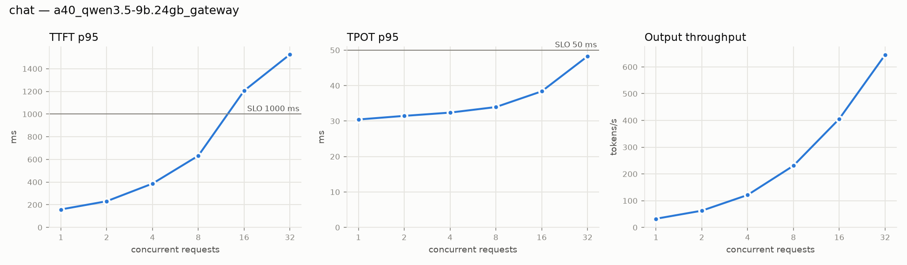

# Benchmark report — a40_qwen3.5-9b.24gb_gateway

- **GPU:** NVIDIA A40 · driver 595.112.07 · PCIe gen4 x16
- **Provider / price:** runpod · $0.59/h
- **Server:** http://127.0.0.1:8000 · model `Qwen/Qwen3.5-9B` · vLLM 0.32.0
- **Methodology:** 1.1 · loadgen 0.1.0 · repo 368de4ad6a
- **Prompt calibration:** 1.000 tokens/word (tokenize)
- **Run:** 2026-11-25T16:25:43.298Z → 2026-11-25T16:51:20.480Z

## chat

512 → 256 tokens. SLO: TTFT p95 ≤ 1000 ms, TPOT p95 ≤ 50 ms, errors < 0.5%.

**Closed loop**

| Load | n | Errors | TTFT p50 / p95 / p99 (ms) | TPOT p50 / p95 (ms) | ITL p99 (ms) | Output tok/s | Req/s | Goodput req/s | SLO | Notes |
|---|---:|---:|---|---|---:|---:|---:|---:|:-:|---|
| c=1 | 30 | 0.0% | 146 / 159 / – | 30.4 / 30.4 | 35.1 | 32 | 0.13 | 0.13 | ✓ | p99 n/a (n=30) |
| c=2 | 31 | 0.0% | 201 / 231 / – | 31.3 / 31.5 | 36.4 | 63 | 0.25 | 0.25 | ✓ | p99 n/a (n=31) |
| c=4 | 44 | 0.0% | 364 / 387 / – | 31.7 / 32.4 | 37.0 | 121 | 0.51 | 0.51 | ✓ | p99 n/a (n=44) |
| c=8 | 85 | 0.0% | 508 / 632 / – | 32.7 / 34.0 | 41.9 | 231 | 0.95 | 0.95 | ✓ | p99 n/a (n=85) |
| c=16 | 141 | 0.0% | 745 / 1,206 / – | 36.4 / 38.4 | 103.8 | 406 | 1.74 | 1.47 | ✗ | p99 n/a (n=141) |
| c=32 | 237 | 0.0% | 972 / 1,526 / – | 45.8 / 48.3 | 254.4 | 645 | 2.66 | 1.34 | ✗ | p99 n/a (n=237) |

**Open loop (Poisson)**

| Load | n | Errors | TTFT p50 / p95 / p99 (ms) | TPOT p50 / p95 (ms) | ITL p99 (ms) | Output tok/s | Req/s | Goodput req/s | SLO | Notes |
|---|---:|---:|---|---|---:|---:|---:|---:|:-:|---|
| 0.588 req/s | 63 | 0.0% | 172 / 199 / – | 33.4 / 34.4 | 92.8 | 177 | 0.70 | 0.70 | ✓ | p99 n/a (n=63) |
| 1.176 req/s | 102 | 0.0% | 178 / 237 / – | 36.3 / 41.5 | 95.0 | 282 | 1.13 | 1.13 | ✓ | p99 n/a (n=102) |
| 1.764 req/s | 122 | 0.0% | 185 / 260 / – | 38.9 / 43.6 | 96.6 | 367 | 1.38 | 1.38 | ✓ | p99 n/a (n=122) |
| 2.117 req/s | 183 | 0.0% | 203 / 292 / – | 45.1 / 47.4 | 108.6 | 511 | 2.00 | 2.00 | ✓ | p99 n/a (n=183) |

- **Capacity (concurrency):** 8 concurrent requests · 231 output tok/s · $0.711 per 1M output tokens · $0.233 per 1M total tokens
- **Capacity (rate):** 2.12 req/s · 511 output tok/s · $0.320 per 1M output tokens · $0.103 per 1M total tokens

Cost assumes the GPU is fully used at the capacity point; setup and idle time are excluded (methodology §6). p99 is shown only with ≥ 300 samples; points where the load generator was the bottleneck are marked invalid and excluded from capacity.
