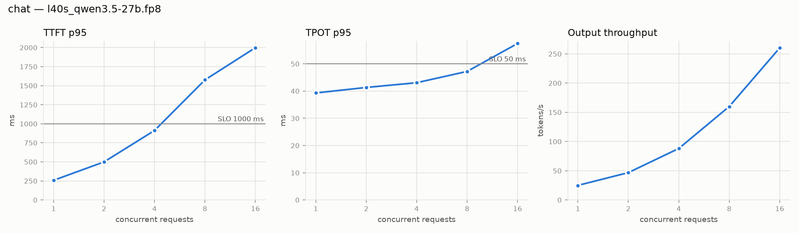
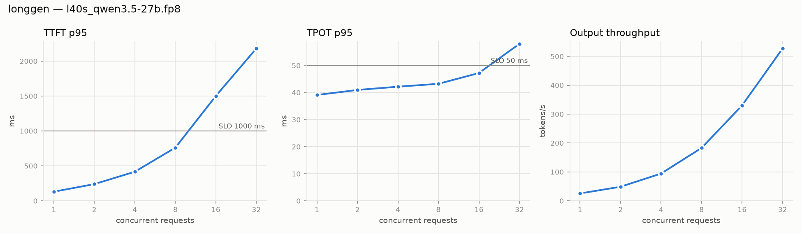
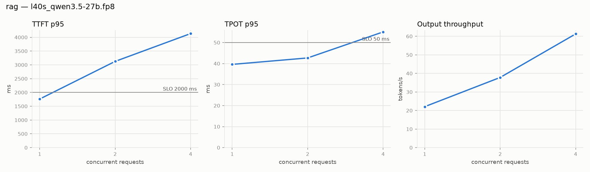

# Benchmark report — l40s_qwen3.5-27b.fp8

- **GPU:** NVIDIA L40S · driver 595.112.07 · PCIe gen4 x16
- **Provider / price:** runpod · $1.09/h
- **Server:** http://127.0.0.1:8000 · model `Qwen/Qwen3.5-27B-FP8` · vLLM 0.32.0
- **Methodology:** 1.1 · loadgen 0.1.0 · repo 9b45fecfd4
- **Prompt calibration:** 1.000 tokens/word (tokenize)
- **Run:** 2026-11-25T22:07:33.277Z → 2026-11-26T00:02:32.452Z

## chat

512 → 256 tokens. SLO: TTFT p95 ≤ 1000 ms, TPOT p95 ≤ 50 ms, errors < 0.5%.

**Closed loop**

| Load | n | Errors | TTFT p50 / p95 / p99 (ms) | TPOT p50 / p95 (ms) | ITL p99 (ms) | Output tok/s | Req/s | Goodput req/s | SLO | Notes |
|---|---:|---:|---|---|---:|---:|---:|---:|:-:|---|
| c=1 | 30 | 0.0% | 256 / 258 / – | 39.3 / 39.3 | 39.6 | 25 | 0.10 | 0.10 | ✓ | p99 n/a (n=30) |
| c=2 | 31 | 0.0% | 406 / 499 / – | 41.0 / 41.3 | 41.4 | 47 | 0.19 | 0.19 | ✓ | p99 n/a (n=31) |
| c=4 | 33 | 0.0% | 907 / 912 / – | 42.0 / 43.1 | 42.6 | 88 | 0.34 | 0.34 | ✓ | p99 n/a (n=33) |
| c=8 | 64 | 0.0% | 1,317 / 1,576 / – | 44.7 / 47.2 | 45.5 | 160 | 0.70 | 0.09 | ✗ | p99 n/a (n=64) |
| c=16 | 96 | 0.0% | 1,829 / 1,999 / – | 53.1 / 57.5 | 294.0 | 260 | 1.20 | 0.00 | ✗ | p99 n/a (n=96) |

**Open loop (Poisson)**

| Load | n | Errors | TTFT p50 / p95 / p99 (ms) | TPOT p50 / p95 (ms) | ITL p99 (ms) | Output tok/s | Req/s | Goodput req/s | SLO | Notes |
|---|---:|---:|---|---|---:|---:|---:|---:|:-:|---|
| 0.259 req/s | 26 | 0.0% | 313 / 422 / – | 43.4 / 46.8 | 133.2 | 80 | 0.34 | 0.34 | ✓ | p99 n/a (n=26) |
| 0.519 req/s | 56 | 0.0% | 335 / 1,129 / – | 48.0 / 55.6 | 167.2 | 130 | 0.49 | 0.32 | ✗ | p99 n/a (n=56) |
| 0.778 req/s | 65 | 0.0% | 332 / 516 / – | 54.2 / 62.8 | 176.8 | 204 | 0.85 | 0.25 | ✗ | p99 n/a (n=65) |
| 0.934 req/s | 100 | 0.0% | 404 / 892 / – | 66.5 / 82.5 | 268.0 | 288 | 1.19 | 0.11 | ✗ | p99 n/a (n=100) |

- **Capacity (concurrency):** 4 concurrent requests · 88 output tok/s · $3.436 per 1M output tokens · $1.128 per 1M total tokens
- **Capacity (rate):** 0.26 req/s · 80 output tok/s · $3.770 per 1M output tokens · $1.330 per 1M total tokens

## longgen

200 → 1000 tokens. SLO: TTFT p95 ≤ 1000 ms, TPOT p95 ≤ 50 ms, errors < 0.5%.

**Closed loop**

| Load | n | Errors | TTFT p50 / p95 / p99 (ms) | TPOT p50 / p95 (ms) | ITL p99 (ms) | Output tok/s | Req/s | Goodput req/s | SLO | Notes |
|---|---:|---:|---|---|---:|---:|---:|---:|:-:|---|
| c=1 | 30 | 0.0% | 128 / 130 / – | 39.1 / 39.1 | 39.7 | 26 | 0.03 | 0.03 | ✓ | p99 n/a (n=30) |
| c=2 | 31 | 0.0% | 162 / 239 / – | 40.9 / 41.0 | 41.9 | 49 | 0.05 | 0.05 | ✓ | p99 n/a (n=31) |
| c=4 | 33 | 0.0% | 410 / 416 / – | 42.0 / 42.2 | 42.8 | 94 | 0.10 | 0.10 | ✓ | p99 n/a (n=33) |
| c=8 | 37 | 0.0% | 749 / 761 / – | 43.0 / 43.2 | 44.0 | 183 | 0.21 | 0.21 | ✓ | p99 n/a (n=37) |
| c=16 | 45 | 0.0% | 1,252 / 1,501 / – | 47.0 / 47.2 | 48.2 | 330 | 0.45 | 0.03 | ✗ | p99 n/a (n=45) |
| c=32 | 64 | 0.0% | 2,152 / 2,182 / – | 57.3 / 58.0 | 59.4 | 527 | 1.04 | 0.00 | ✗ | p99 n/a (n=64) |

**Open loop (Poisson)**

| Load | n | Errors | TTFT p50 / p95 / p99 (ms) | TPOT p50 / p95 (ms) | ITL p99 (ms) | Output tok/s | Req/s | Goodput req/s | SLO | Notes |
|---|---:|---:|---|---|---:|---:|---:|---:|:-:|---|
| 0.135 req/s | 12 | 0.0% | 184 / 199 / – | 42.3 / 42.6 | 47.3 | 146 | 0.12 | 0.12 | ✓ | p99 n/a (n=12) |
| 0.269 req/s | 27 | 0.0% | 195 / 221 / – | 45.3 / 46.4 | 87.5 | 209 | 0.16 | 0.16 | ✓ | p99 n/a (n=27) |
| 0.404 req/s | 36 | 0.0% | 220 / 254 / – | 52.4 / 53.2 | 116.1 | 413 | 0.37 | 0.11 | ✗ | p99 n/a (n=36) |
| 0.484 req/s | 45 | 0.0% | 227 / 312 / – | 54.6 / 55.7 | 118.4 | 455 | 0.38 | 0.08 | ✗ | p99 n/a (n=45) |

- **Capacity (concurrency):** 8 concurrent requests · 183 output tok/s · $1.653 per 1M output tokens · $1.364 per 1M total tokens
- **Capacity (rate):** 0.27 req/s · 209 output tok/s · $1.446 per 1M output tokens · $1.118 per 1M total tokens

## rag

4000 → 300 tokens. SLO: TTFT p95 ≤ 2000 ms, TPOT p95 ≤ 50 ms, errors < 0.5%.

**Closed loop**

| Load | n | Errors | TTFT p50 / p95 / p99 (ms) | TPOT p50 / p95 (ms) | ITL p99 (ms) | Output tok/s | Req/s | Goodput req/s | SLO | Notes |
|---|---:|---:|---|---|---:|---:|---:|---:|:-:|---|
| c=1 | 30 | 0.0% | 1,758 / 1,761 / – | 39.6 / 39.6 | 39.9 | 22 | 0.08 | 0.08 | ✓ | p99 n/a (n=30) |
| c=2 | 31 | 0.0% | 3,115 / 3,126 / – | 42.7 / 42.7 | 42.3 | 38 | 0.13 | 0.00 | ✗ | p99 n/a (n=31) |
| c=4 | 33 | 0.0% | 3,176 / 4,134 / – | 51.9 / 55.1 | 666.8 | 61 | 0.21 | 0.01 | ✗ | p99 n/a (n=33) |

**Open loop (Poisson)**

| Load | n | Errors | TTFT p50 / p95 / p99 (ms) | TPOT p50 / p95 (ms) | ITL p99 (ms) | Output tok/s | Req/s | Goodput req/s | SLO | Notes |
|---|---:|---:|---|---|---:|---:|---:|---:|:-:|---|
| 0.048 req/s | 4 | 0.0% | 1,752 / 1,811 / – | 40.4 / 45.8 | 42.2 | 14 | 0.05 | 0.05 | ✓ | p99 n/a (n=4) |
| 0.097 req/s | 8 | 0.0% | 1,814 / 2,617 / – | 47.6 / 55.7 | 415.0 | 32 | 0.10 | 0.06 | ✗ | p99 n/a (n=8) |
| 0.145 req/s | 10 | 0.0% | 1,827 / 3,093 / – | 44.7 / 59.9 | 303.6 | 27 | 0.10 | 0.05 | ✗ | p99 n/a (n=10) |
| 0.174 req/s | 15 | 0.0% | 1,926 / 3,157 / – | 53.8 / 65.8 | 468.5 | 45 | 0.11 | 0.03 | ✗ | p99 n/a (n=15) |

- **Capacity (concurrency):** 1 concurrent requests · 22 output tok/s · $13.723 per 1M output tokens · $0.955 per 1M total tokens
- **Capacity (rate):** 0.05 req/s · 14 output tok/s · $21.406 per 1M output tokens · $1.489 per 1M total tokens

Cost assumes the GPU is fully used at the capacity point; setup and idle time are excluded (methodology §6). p99 is shown only with ≥ 300 samples; points where the load generator was the bottleneck are marked invalid and excluded from capacity.
