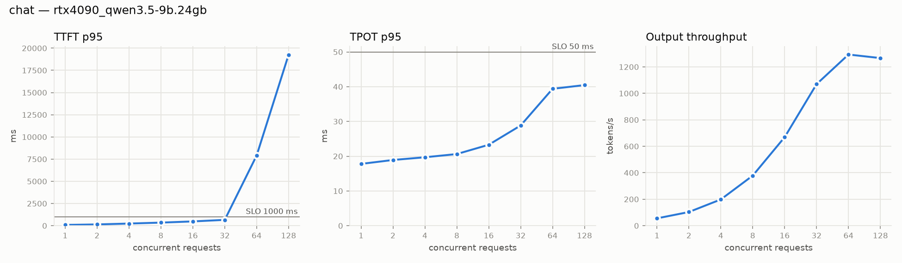
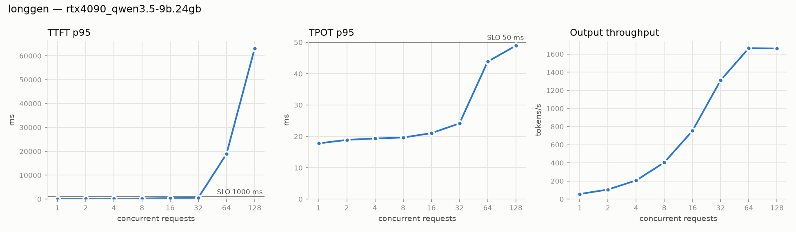
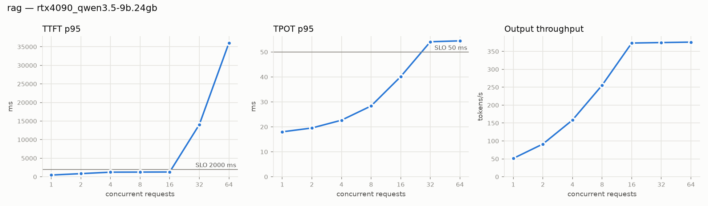

# Benchmark report — rtx4090_qwen3.5-9b.24gb

- **GPU:** NVIDIA GeForce RTX 4090 · driver 595.112.07 · PCIe gen4 x8
- **Provider / price:** runpod · $0.89/h
- **Server:** http://127.0.0.1:8000 · model `Qwen/Qwen3.5-9B` · vLLM 0.32.0
- **Methodology:** 1.1 · loadgen 0.1.0 · repo 6eb8c5d49d
- **Prompt calibration:** 1.000 tokens/word (tokenize)
- **Run:** 2026-11-25T19:41:34.506Z → 2026-11-25T21:16:33.502Z

## chat

512 → 256 tokens. SLO: TTFT p95 ≤ 1000 ms, TPOT p95 ≤ 50 ms, errors < 0.5%.

**Closed loop**

| Load | n | Errors | TTFT p50 / p95 / p99 (ms) | TPOT p50 / p95 (ms) | ITL p99 (ms) | Output tok/s | Req/s | Goodput req/s | SLO | Notes |
|---|---:|---:|---|---|---:|---:|---:|---:|:-:|---|
| c=1 | 30 | 0.0% | 87 / 89 / – | 17.8 / 17.8 | 19.1 | 55 | 0.22 | 0.22 | ✓ | p99 n/a (n=30) |
| c=2 | 38 | 0.0% | 137 / 144 / – | 18.9 / 18.9 | 20.6 | 103 | 0.43 | 0.43 | ✓ | p99 n/a (n=38) |
| c=4 | 69 | 0.0% | 233 / 242 / – | 19.3 / 19.7 | 20.8 | 198 | 0.77 | 0.77 | ✓ | p99 n/a (n=69) |
| c=8 | 133 | 0.0% | 314 / 349 / – | 20.0 / 20.6 | 27.0 | 378 | 1.52 | 1.52 | ✓ | p99 n/a (n=133) |
| c=16 | 237 | 0.0% | 437 / 483 / – | 22.2 / 23.3 | 117.7 | 669 | 2.76 | 2.76 | ✓ | p99 n/a (n=237) |
| c=32 | 331 | 0.0% | 499 / 658 / 668 | 27.9 / 28.8 | 165.4 | 1,070 | 4.32 | 4.32 | ✓ |  |
| c=64 | 363 | 0.0% | 1,297 / 7,910 / 8,007 | 37.0 / 39.4 | 176.7 | 1,293 | 5.22 | 0.36 | ✗ |  |
| c=128 | 427 | 0.0% | 18,370 / 19,248 / 19,391 | 38.4 / 40.5 | 177.2 | 1,267 | 5.23 | 0.00 | ✗ |  |

**Open loop (Poisson)**

| Load | n | Errors | TTFT p50 / p95 / p99 (ms) | TPOT p50 / p95 (ms) | ITL p99 (ms) | Output tok/s | Req/s | Goodput req/s | SLO | Notes |
|---|---:|---:|---|---|---:|---:|---:|---:|:-:|---|
| 1.172 req/s | 115 | 0.0% | 110 / 148 / – | 20.7 / 21.8 | 73.6 | 330 | 1.26 | 1.26 | ✓ | p99 n/a (n=115) |
| 2.344 req/s | 177 | 0.0% | 109 / 161 / – | 22.1 / 25.3 | 75.1 | 501 | 1.93 | 1.93 | ✓ | p99 n/a (n=177) |
| 3.516 req/s | 300 | 0.0% | 120 / 177 / 216 | 26.6 / 29.7 | 76.4 | 876 | 3.47 | 3.47 | ✓ |  |
| 4.22 req/s | 300 | 0.0% | 127 / 204 / 244 | 27.9 / 29.4 | 78.3 | 961 | 3.71 | 3.71 | ✓ |  |

- **Capacity (concurrency):** 32 concurrent requests · 1,070 output tok/s · $0.231 per 1M output tokens · $0.074 per 1M total tokens
- **Capacity (rate):** 4.22 req/s · 961 output tok/s · $0.257 per 1M output tokens · $0.084 per 1M total tokens

## longgen

200 → 1000 tokens. SLO: TTFT p95 ≤ 1000 ms, TPOT p95 ≤ 50 ms, errors < 0.5%.

**Closed loop**

| Load | n | Errors | TTFT p50 / p95 / p99 (ms) | TPOT p50 / p95 (ms) | ITL p99 (ms) | Output tok/s | Req/s | Goodput req/s | SLO | Notes |
|---|---:|---:|---|---|---:|---:|---:|---:|:-:|---|
| c=1 | 30 | 0.0% | 72 / 75 / – | 17.8 / 17.8 | 19.0 | 56 | 0.06 | 0.06 | ✓ | p99 n/a (n=30) |
| c=2 | 31 | 0.0% | 102 / 120 / – | 18.9 / 18.9 | 20.3 | 105 | 0.11 | 0.11 | ✓ | p99 n/a (n=31) |
| c=4 | 33 | 0.0% | 126 / 136 / – | 19.3 / 19.3 | 21.1 | 206 | 0.21 | 0.21 | ✓ | p99 n/a (n=33) |
| c=8 | 40 | 0.0% | 199 / 233 / – | 19.6 / 19.6 | 22.5 | 404 | 0.50 | 0.50 | ✓ | p99 n/a (n=40) |
| c=16 | 80 | 0.0% | 337 / 412 / – | 20.9 / 21.0 | 24.1 | 753 | 0.93 | 0.93 | ✓ | p99 n/a (n=80) |
| c=32 | 109 | 0.0% | 364 / 600 / – | 23.9 / 24.1 | 31.5 | 1,310 | 1.49 | 1.49 | ✓ | p99 n/a (n=109) |
| c=64 | 161 | 0.0% | 1,893 / 18,900 / – | 31.0 / 43.9 | 121.7 | 1,665 | 1.80 | 0.68 | ✗ | p99 n/a (n=161) |
| c=128 | 162 | 0.0% | 38,186 / 63,098 / – | 31.4 / 48.9 | 107.1 | 1,662 | 1.79 | 0.00 | ✗ | p99 n/a (n=162) |

**Open loop (Poisson)**

| Load | n | Errors | TTFT p50 / p95 / p99 (ms) | TPOT p50 / p95 (ms) | ITL p99 (ms) | Output tok/s | Req/s | Goodput req/s | SLO | Notes |
|---|---:|---:|---|---|---:|---:|---:|---:|:-:|---|
| 0.345 req/s | 33 | 0.0% | 92 / 116 / – | 20.0 / 20.6 | 31.1 | 387 | 0.39 | 0.39 | ✓ | p99 n/a (n=33) |
| 0.69 req/s | 73 | 0.0% | 93 / 104 / – | 21.5 / 22.3 | 64.5 | 779 | 0.72 | 0.72 | ✓ | p99 n/a (n=73) |
| 1.034 req/s | 106 | 0.0% | 101 / 133 / – | 23.4 / 24.9 | 64.8 | 1,119 | 1.00 | 1.00 | ✓ | p99 n/a (n=106) |
| 1.241 req/s | 119 | 0.0% | 100 / 139 / – | 24.3 / 25.1 | 65.7 | 1,317 | 1.31 | 1.31 | ✓ | p99 n/a (n=119) |

- **Capacity (concurrency):** 32 concurrent requests · 1,310 output tok/s · $0.189 per 1M output tokens · $0.152 per 1M total tokens
- **Capacity (rate):** 1.24 req/s · 1,317 output tok/s · $0.188 per 1M output tokens · $0.155 per 1M total tokens

## rag

4000 → 300 tokens. SLO: TTFT p95 ≤ 2000 ms, TPOT p95 ≤ 50 ms, errors < 0.5%.

**Closed loop**

| Load | n | Errors | TTFT p50 / p95 / p99 (ms) | TPOT p50 / p95 (ms) | ITL p99 (ms) | Output tok/s | Req/s | Goodput req/s | SLO | Notes |
|---|---:|---:|---|---|---:|---:|---:|---:|:-:|---|
| c=1 | 30 | 0.0% | 467 / 470 / – | 18.0 / 18.0 | 19.2 | 51 | 0.17 | 0.17 | ✓ | p99 n/a (n=30) |
| c=2 | 31 | 0.0% | 723 / 847 / – | 19.1 / 19.5 | 21.5 | 91 | 0.30 | 0.30 | ✓ | p99 n/a (n=31) |
| c=4 | 48 | 0.0% | 1,027 / 1,241 / – | 21.6 / 22.7 | 103.8 | 158 | 0.56 | 0.56 | ✓ | p99 n/a (n=48) |
| c=8 | 77 | 0.0% | 1,254 / 1,263 / – | 26.7 / 28.4 | 200.0 | 256 | 0.90 | 0.90 | ✓ | p99 n/a (n=77) |
| c=16 | 112 | 0.0% | 1,283 / 1,289 / – | 38.9 / 40.1 | 208.0 | 373 | 1.25 | 1.25 | ✓ | p99 n/a (n=112) |
| c=32 | 111 | 0.0% | 7,022 / 14,052 / – | 52.4 / 54.1 | 210.5 | 375 | 1.27 | 0.00 | ✗ | p99 n/a (n=111) |
| c=64 | 111 | 0.0% | 35,722 / 36,041 / – | 52.7 / 54.5 | 209.9 | 376 | 1.27 | 0.00 | ✗ | p99 n/a (n=111) |

**Open loop (Poisson)**

| Load | n | Errors | TTFT p50 / p95 / p99 (ms) | TPOT p50 / p95 (ms) | ITL p99 (ms) | Output tok/s | Req/s | Goodput req/s | SLO | Notes |
|---|---:|---:|---|---|---:|---:|---:|---:|:-:|---|
| 0.289 req/s | 30 | 0.0% | 492 / 635 / – | 21.2 / 26.6 | 105.9 | 94 | 0.31 | 0.31 | ✓ | p99 n/a (n=30) |
| 0.578 req/s | 48 | 0.0% | 500 / 842 / – | 24.1 / 33.6 | 165.0 | 161 | 0.54 | 0.54 | ✓ | p99 n/a (n=48) |
| 0.867 req/s | 87 | 0.0% | 683 / 1,775 / – | 31.9 / 51.5 | 182.7 | 295 | 1.03 | 0.89 | ✗ | p99 n/a (n=87) |
| 1.04 req/s | 110 | 0.0% | 4,005 / 9,401 / – | 53.8 / 58.9 | 208.1 | 374 | 1.10 | 0.07 | ✗ | p99 n/a (n=110) |

- **Capacity (concurrency):** 16 concurrent requests · 373 output tok/s · $0.662 per 1M output tokens · $0.046 per 1M total tokens
- **Capacity (rate):** 0.58 req/s · 161 output tok/s · $1.540 per 1M output tokens · $0.108 per 1M total tokens

Cost assumes the GPU is fully used at the capacity point; setup and idle time are excluded (methodology §6). p99 is shown only with ≥ 300 samples; points where the load generator was the bottleneck are marked invalid and excluded from capacity.
