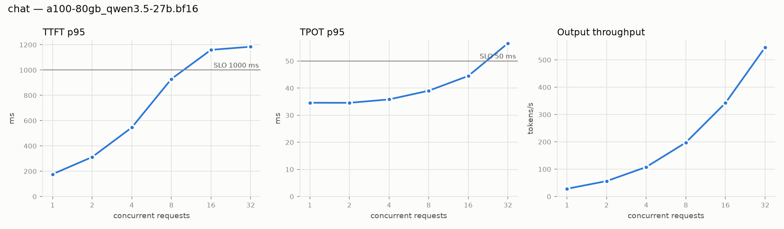
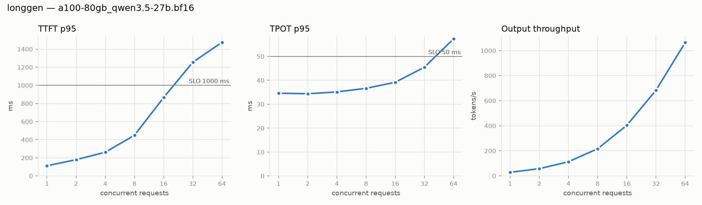
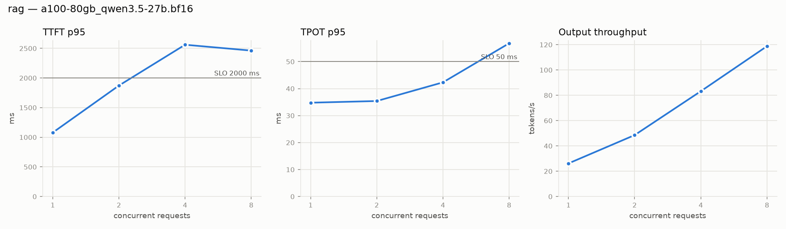

# Benchmark report — a100-80gb_qwen3.5-27b.bf16

- **GPU:** NVIDIA A100-SXM4-80GB · driver 595.112.07 · PCIe gen4 x16
- **Provider / price:** runpod · $2.19/h
- **Server:** http://127.0.0.1:8000 · model `Qwen/Qwen3.5-27B` · vLLM 0.32.0
- **Methodology:** 1.1 · loadgen 0.1.0 · repo 9b45fecfd4
- **Prompt calibration:** 1.000 tokens/word (tokenize)
- **Run:** 2026-11-26T03:23:40.662Z → 2026-11-26T05:14:47.626Z

## chat

512 → 256 tokens. SLO: TTFT p95 ≤ 1000 ms, TPOT p95 ≤ 50 ms, errors < 0.5%.

**Closed loop**

| Load | n | Errors | TTFT p50 / p95 / p99 (ms) | TPOT p50 / p95 (ms) | ITL p99 (ms) | Output tok/s | Req/s | Goodput req/s | SLO | Notes |
|---|---:|---:|---|---|---:|---:|---:|---:|:-:|---|
| c=1 | 30 | 0.0% | 171 / 177 / – | 34.6 / 34.6 | 37.0 | 28 | 0.11 | 0.11 | ✓ | p99 n/a (n=30) |
| c=2 | 31 | 0.0% | 253 / 312 / – | 34.5 / 34.6 | 35.3 | 56 | 0.22 | 0.22 | ✓ | p99 n/a (n=31) |
| c=4 | 40 | 0.0% | 539 / 546 / – | 35.1 / 35.8 | 36.4 | 108 | 0.47 | 0.47 | ✓ | p99 n/a (n=40) |
| c=8 | 72 | 0.0% | 754 / 930 / – | 37.5 / 39.0 | 44.6 | 198 | 0.87 | 0.87 | ✓ | p99 n/a (n=72) |
| c=16 | 125 | 0.0% | 1,038 / 1,160 / – | 42.3 / 44.5 | 211.8 | 342 | 1.49 | 0.63 | ✗ | p99 n/a (n=125) |
| c=32 | 186 | 0.0% | 1,173 / 1,185 / – | 54.9 / 56.5 | 390.1 | 546 | 2.07 | 0.07 | ✗ | p99 n/a (n=186) |

**Open loop (Poisson)**

| Load | n | Errors | TTFT p50 / p95 / p99 (ms) | TPOT p50 / p95 (ms) | ITL p99 (ms) | Output tok/s | Req/s | Goodput req/s | SLO | Notes |
|---|---:|---:|---|---|---:|---:|---:|---:|:-:|---|
| 0.462 req/s | 43 | 0.0% | 217 / 306 / – | 38.1 / 39.0 | 102.0 | 131 | 0.48 | 0.48 | ✓ | p99 n/a (n=43) |
| 0.924 req/s | 84 | 0.0% | 226 / 342 / – | 43.1 / 45.3 | 107.8 | 256 | 1.00 | 1.00 | ✓ | p99 n/a (n=84) |
| 1.386 req/s | 124 | 0.0% | 245 / 359 / – | 49.0 / 54.4 | 151.6 | 366 | 1.48 | 0.87 | ✗ | p99 n/a (n=124) |
| 1.664 req/s | 153 | 0.0% | 247 / 434 / – | 52.9 / 56.7 | 162.2 | 413 | 1.56 | 0.42 | ✗ | p99 n/a (n=153) |

- **Capacity (concurrency):** 8 concurrent requests · 198 output tok/s · $3.078 per 1M output tokens · $1.011 per 1M total tokens
- **Capacity (rate):** 0.92 req/s · 256 output tok/s · $2.381 per 1M output tokens · $0.801 per 1M total tokens

## longgen

200 → 1000 tokens. SLO: TTFT p95 ≤ 1000 ms, TPOT p95 ≤ 50 ms, errors < 0.5%.

**Closed loop**

| Load | n | Errors | TTFT p50 / p95 / p99 (ms) | TPOT p50 / p95 (ms) | ITL p99 (ms) | Output tok/s | Req/s | Goodput req/s | SLO | Notes |
|---|---:|---:|---|---|---:|---:|---:|---:|:-:|---|
| c=1 | 30 | 0.0% | 108 / 112 / – | 34.6 / 34.6 | 35.4 | 29 | 0.03 | 0.03 | ✓ | p99 n/a (n=30) |
| c=2 | 31 | 0.0% | 167 / 180 / – | 34.4 / 34.4 | 35.3 | 58 | 0.06 | 0.06 | ✓ | p99 n/a (n=31) |
| c=4 | 33 | 0.0% | 247 / 262 / – | 35.1 / 35.1 | 36.5 | 113 | 0.11 | 0.11 | ✓ | p99 n/a (n=33) |
| c=8 | 37 | 0.0% | 419 / 449 / – | 36.5 / 36.6 | 37.7 | 217 | 0.24 | 0.24 | ✓ | p99 n/a (n=37) |
| c=16 | 48 | 0.0% | 747 / 865 / – | 38.9 / 39.2 | 40.9 | 404 | 0.60 | 0.60 | ✓ | p99 n/a (n=48) |
| c=32 | 64 | 0.0% | 1,089 / 1,256 / – | 45.1 / 45.5 | 49.7 | 684 | 1.36 | 0.60 | ✗ | p99 n/a (n=64) |
| c=64 | 128 | 0.0% | 1,376 / 1,475 / – | 56.8 / 57.3 | 59.4 | 1,064 | 2.11 | 0.00 | ✗ | p99 n/a (n=128) |

**Open loop (Poisson)**

| Load | n | Errors | TTFT p50 / p95 / p99 (ms) | TPOT p50 / p95 (ms) | ITL p99 (ms) | Output tok/s | Req/s | Goodput req/s | SLO | Notes |
|---|---:|---:|---|---|---:|---:|---:|---:|:-:|---|
| 0.274 req/s | 17 | 0.0% | 142 / 158 / – | 36.5 / 36.6 | 46.1 | 172 | 0.16 | 0.16 | ✓ | p99 n/a (n=17) |
| 0.549 req/s | 57 | 0.0% | 170 / 207 / – | 46.6 / 47.5 | 90.0 | 640 | 0.58 | 0.58 | ✓ | p99 n/a (n=57) |
| 0.823 req/s | 95 | 0.0% | 201 / 249 / – | 53.4 / 55.8 | 105.0 | 864 | 0.65 | 0.10 | ✗ | p99 n/a (n=95) |
| 0.988 req/s | 82 | 0.0% | 222 / 300 / – | 56.0 / 57.6 | 110.6 | 970 | 0.85 | 0.12 | ✗ | p99 n/a (n=82) |

- **Capacity (concurrency):** 16 concurrent requests · 404 output tok/s · $1.507 per 1M output tokens · $1.237 per 1M total tokens
- **Capacity (rate):** 0.55 req/s · 640 output tok/s · $0.951 per 1M output tokens · $0.787 per 1M total tokens

## rag

4000 → 300 tokens. SLO: TTFT p95 ≤ 2000 ms, TPOT p95 ≤ 50 ms, errors < 0.5%.

**Closed loop**

| Load | n | Errors | TTFT p50 / p95 / p99 (ms) | TPOT p50 / p95 (ms) | ITL p99 (ms) | Output tok/s | Req/s | Goodput req/s | SLO | Notes |
|---|---:|---:|---|---|---:|---:|---:|---:|:-:|---|
| c=1 | 30 | 0.0% | 1,073 / 1,078 / – | 34.8 / 34.8 | 35.3 | 26 | 0.09 | 0.09 | ✓ | p99 n/a (n=30) |
| c=2 | 31 | 0.0% | 1,782 / 1,872 / – | 35.1 / 35.4 | 37.9 | 49 | 0.16 | 0.16 | ✓ | p99 n/a (n=31) |
| c=4 | 33 | 0.0% | 2,260 / 2,561 / – | 40.5 / 42.3 | 376.7 | 83 | 0.28 | 0.13 | ✗ | p99 n/a (n=33) |
| c=8 | 40 | 0.0% | 2,457 / 2,462 / – | 54.8 / 56.8 | 416.1 | 119 | 0.49 | 0.01 | ✗ | p99 n/a (n=40) |

**Open loop (Poisson)**

| Load | n | Errors | TTFT p50 / p95 / p99 (ms) | TPOT p50 / p95 (ms) | ITL p99 (ms) | Output tok/s | Req/s | Goodput req/s | SLO | Notes |
|---|---:|---:|---|---|---:|---:|---:|---:|:-:|---|
| 0.105 req/s | 14 | 0.0% | 1,135 / 1,259 / – | 41.2 / 47.2 | 315.0 | 36 | 0.10 | 0.10 | ✓ | p99 n/a (n=14) |
| 0.211 req/s | 12 | 0.0% | 1,128 / 1,911 / – | 38.6 / 41.6 | 207.7 | 47 | 0.16 | 0.15 | ✓ | p99 n/a (n=12) |
| 0.316 req/s | 16 | 0.0% | 1,136 / 2,255 / – | 40.1 / 49.3 | 317.6 | 57 | 0.25 | 0.20 | ✗ | p99 n/a (n=16) |
| 0.38 req/s | 43 | 0.0% | 1,905 / 3,128 / – | 67.9 / 85.9 | 424.7 | 152 | 0.51 | 0.08 | ✗ | p99 n/a (n=43) |

- **Capacity (concurrency):** 2 concurrent requests · 49 output tok/s · $12.534 per 1M output tokens · $0.872 per 1M total tokens
- **Capacity (rate):** 0.21 req/s · 47 output tok/s · $12.914 per 1M output tokens · $0.889 per 1M total tokens

Cost assumes the GPU is fully used at the capacity point; setup and idle time are excluded (methodology §6). p99 is shown only with ≥ 300 samples; points where the load generator was the bottleneck are marked invalid and excluded from capacity.
