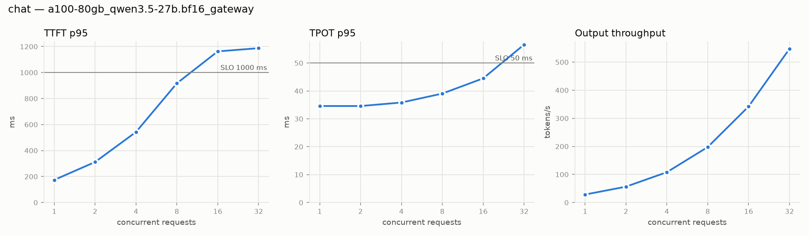

# Benchmark report — a100-80gb_qwen3.5-27b.bf16_gateway

- **GPU:** NVIDIA A100-SXM4-80GB · driver 595.112.07 · PCIe gen4 x16
- **Provider / price:** runpod · $2.19/h
- **Server:** http://127.0.0.1:8000 · model `Qwen/Qwen3.5-27B` · vLLM 0.32.0
- **Methodology:** 1.1 · loadgen 0.1.0 · repo 9b45fecfd4
- **Prompt calibration:** 1.000 tokens/word (tokenize)
- **Run:** 2026-11-26T05:14:50.641Z → 2026-11-26T05:42:08.105Z

## chat

512 → 256 tokens. SLO: TTFT p95 ≤ 1000 ms, TPOT p95 ≤ 50 ms, errors < 0.5%.

**Closed loop**

| Load | n | Errors | TTFT p50 / p95 / p99 (ms) | TPOT p50 / p95 (ms) | ITL p99 (ms) | Output tok/s | Req/s | Goodput req/s | SLO | Notes |
|---|---:|---:|---|---|---:|---:|---:|---:|:-:|---|
| c=1 | 30 | 0.0% | 171 / 174 / – | 34.6 / 34.6 | 35.6 | 28 | 0.11 | 0.11 | ✓ | p99 n/a (n=30) |
| c=2 | 31 | 0.0% | 253 / 312 / – | 34.6 / 34.6 | 37.0 | 56 | 0.22 | 0.22 | ✓ | p99 n/a (n=31) |
| c=4 | 40 | 0.0% | 538 / 543 / – | 35.1 / 35.8 | 37.7 | 108 | 0.46 | 0.46 | ✓ | p99 n/a (n=40) |
| c=8 | 72 | 0.0% | 757 / 917 / – | 37.6 / 39.0 | 44.4 | 198 | 0.85 | 0.85 | ✓ | p99 n/a (n=72) |
| c=16 | 125 | 0.0% | 1,036 / 1,163 / – | 42.3 / 44.5 | 212.2 | 342 | 1.49 | 0.63 | ✗ | p99 n/a (n=125) |
| c=32 | 183 | 0.0% | 1,177 / 1,187 / – | 55.0 / 56.6 | 391.9 | 547 | 2.04 | 0.06 | ✗ | p99 n/a (n=183) |

**Open loop (Poisson)**

| Load | n | Errors | TTFT p50 / p95 / p99 (ms) | TPOT p50 / p95 (ms) | ITL p99 (ms) | Output tok/s | Req/s | Goodput req/s | SLO | Notes |
|---|---:|---:|---|---|---:|---:|---:|---:|:-:|---|
| 0.457 req/s | 38 | 0.0% | 218 / 273 / – | 37.5 / 40.1 | 103.1 | 110 | 0.45 | 0.45 | ✓ | p99 n/a (n=38) |
| 0.914 req/s | 85 | 0.0% | 232 / 377 / – | 42.0 / 45.9 | 107.2 | 233 | 0.86 | 0.86 | ✓ | p99 n/a (n=85) |
| 1.37 req/s | 123 | 0.0% | 246 / 426 / – | 49.2 / 54.7 | 158.4 | 353 | 1.38 | 0.82 | ✗ | p99 n/a (n=123) |
| 1.644 req/s | 153 | 0.0% | 252 / 402 / – | 52.4 / 58.3 | 161.9 | 428 | 1.67 | 0.42 | ✗ | p99 n/a (n=153) |

- **Capacity (concurrency):** 8 concurrent requests · 198 output tok/s · $3.080 per 1M output tokens · $1.012 per 1M total tokens
- **Capacity (rate):** 0.91 req/s · 233 output tok/s · $2.605 per 1M output tokens · $0.845 per 1M total tokens

Cost assumes the GPU is fully used at the capacity point; setup and idle time are excluded (methodology §6). p99 is shown only with ≥ 300 samples; points where the load generator was the bottleneck are marked invalid and excluded from capacity.
