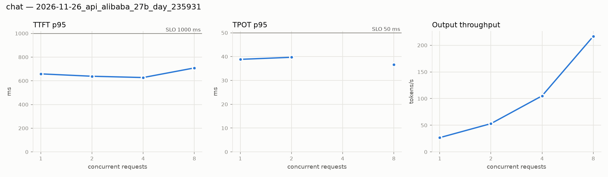
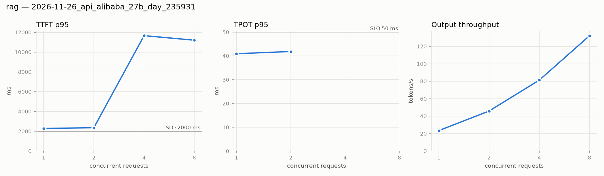

# Benchmark report — 2026-11-26_api_alibaba_27b_day_235931

- **GPU:** none (local)
- **Provider / price:** – · price not set (GPU_PRICE_PER_HOUR_USD or --price)
- **Server:** https://openrouter.ai · model `qwen/qwen3.5-27b`
- **Methodology:** – · loadgen 0.1.0 · repo –
- **Prompt calibration:** 1.000 tokens/word (fixed)
- **Run:** 2026-11-26T23:59:31.331Z → 2026-11-27T00:24:21.115Z

## chat

512 → 256 tokens. SLO: TTFT p95 ≤ 1000 ms, TPOT p95 ≤ 50 ms, errors < 0.5%.

**Closed loop**

| Load | n | Errors | TTFT p50 / p95 / p99 (ms) | TPOT p50 / p95 (ms) | ITL p99 (ms) | Output tok/s | Req/s | Goodput req/s | SLO | Notes |
|---|---:|---:|---|---|---:|---:|---:|---:|:-:|---|
| c=1 | 30 | 0.0% | 606 / 658 / – | 34.9 / 38.8 | 422.8 | 27 | 0.10 | 0.10 | ✓ | p99 n/a (n=30) |
| c=2 | 31 | 0.0% | 606 / 638 / – | 35.4 / 39.7 | 406.3 | 53 | 0.21 | 0.21 | ✓ | p99 n/a (n=31) |
| c=4 | 33 | 3.0% | 606 / 627 / – | – / – | 433.0 | 105 | 0.44 | 0.44 | ✗ | p99 n/a (n=33); http_403 |
| c=8 | 56 | 0.0% | 605 / 709 / – | 34.5 / 36.7 | 423.1 | 217 | 0.95 | 0.93 | ✓ | p99 n/a (n=56) |

- **Capacity (concurrency):** 8 concurrent requests · 217 output tok/s · $– per 1M output tokens · $– per 1M total tokens

## rag

4000 → 300 tokens. SLO: TTFT p95 ≤ 2000 ms, TPOT p95 ≤ 50 ms, errors < 0.5%.

**Closed loop**

| Load | n | Errors | TTFT p50 / p95 / p99 (ms) | TPOT p50 / p95 (ms) | ITL p99 (ms) | Output tok/s | Req/s | Goodput req/s | SLO | Notes |
|---|---:|---:|---|---|---:|---:|---:|---:|:-:|---|
| c=1 | 30 | 0.0% | 2,219 / 2,284 / – | 34.4 / 40.9 | 418.2 | 23 | 0.08 | 0.00 | ✗ | p99 n/a (n=30) |
| c=2 | 31 | 0.0% | 2,214 / 2,356 / – | 35.6 / 41.8 | 419.4 | 46 | 0.15 | 0.00 | ✗ | p99 n/a (n=31) |
| c=4 | 33 | 3.0% | 2,210 / 11,660 / – | – / – | 415.5 | 81 | 0.29 | 0.00 | ✗ | p99 n/a (n=33); http_429 |
| c=8 | 37 | 21.6% | 2,242 / 11,201 / – | – / – | 412.6 | 132 | 0.44 | 0.00 | ✗ | p99 n/a (n=37); http_429 |

- **Capacity (concurrency):** – concurrent requests · – output tok/s · $– per 1M output tokens · $– per 1M total tokens

Cost assumes the GPU is fully used at the capacity point; setup and idle time are excluded (methodology §6). p99 is shown only with ≥ 300 samples; points where the load generator was the bottleneck are marked invalid and excluded from capacity.
