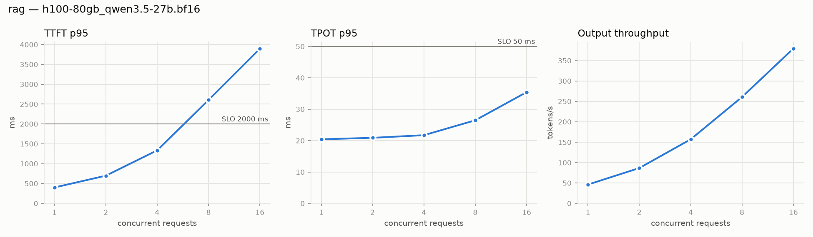

# Benchmark report — h100-80gb_qwen3.5-27b.bf16

- **GPU:** NVIDIA H100 80GB HBM3 · driver 595.112.07 · PCIe gen5 x16
- **Provider / price:** runpod · $4.39/h
- **Server:** http://127.0.0.1:8000 · model `Qwen/Qwen3.5-27B` · vLLM 0.32.0
- **Methodology:** 1.1 · loadgen 0.1.0 · repo 9b45fecfd4
- **Prompt calibration:** 1.000 tokens/word (tokenize)
- **Run:** 2026-11-26T14:01:26.657Z → 2026-11-26T14:24:11.904Z

## rag

4000 → 300 tokens. SLO: TTFT p95 ≤ 2000 ms, TPOT p95 ≤ 50 ms, errors < 0.5%.

**Closed loop**

| Load | n | Errors | TTFT p50 / p95 / p99 (ms) | TPOT p50 / p95 (ms) | ITL p99 (ms) | Output tok/s | Req/s | Goodput req/s | SLO | Notes |
|---|---:|---:|---|---|---:|---:|---:|---:|:-:|---|
| c=1 | 30 | 0.0% | 397 / 401 / – | 20.4 / 20.4 | 21.0 | 46 | 0.15 | 0.15 | ✓ | p99 n/a (n=30) |
| c=2 | 31 | 0.0% | 686 / 698 / – | 20.9 / 20.9 | 21.6 | 87 | 0.29 | 0.29 | ✓ | p99 n/a (n=31) |
| c=4 | 48 | 0.0% | 1,329 / 1,336 / – | 21.1 / 21.7 | 21.9 | 157 | 0.56 | 0.56 | ✓ | p99 n/a (n=48) |
| c=8 | 77 | 0.0% | 2,431 / 2,605 / – | 22.7 / 26.5 | 24.3 | 261 | 0.92 | 0.32 | ✗ | p99 n/a (n=77) |
| c=16 | 125 | 0.0% | 3,208 / 3,896 / – | 30.1 / 35.4 | 433.6 | 379 | 1.40 | 0.22 | ✗ | p99 n/a (n=125) |

**Open loop (Poisson)**

| Load | n | Errors | TTFT p50 / p95 / p99 (ms) | TPOT p50 / p95 (ms) | ITL p99 (ms) | Output tok/s | Req/s | Goodput req/s | SLO | Notes |
|---|---:|---:|---|---|---:|---:|---:|---:|:-:|---|
| 0.32 req/s | 33 | 0.0% | 414 / 703 / – | 22.8 / 26.6 | 166.2 | 102 | 0.35 | 0.35 | ✓ | p99 n/a (n=33) |
| 0.64 req/s | 62 | 0.0% | 416 / 729 / – | 26.2 / 31.3 | 170.5 | 201 | 0.60 | 0.60 | ✓ | p99 n/a (n=62) |
| 0.959 req/s | 80 | 0.0% | 434 / 1,211 / – | 28.5 / 47.2 | 188.9 | 270 | 0.93 | 0.93 | ✓ | p99 n/a (n=80) |
| 1.151 req/s | 96 | 0.0% | 557 / 1,195 / – | 35.4 / 42.6 | 195.3 | 356 | 1.22 | 1.22 | ✓ | p99 n/a (n=96) |

- **Capacity (concurrency):** 4 concurrent requests · 157 output tok/s · $7.768 per 1M output tokens · $0.541 per 1M total tokens
- **Capacity (rate):** 1.15 req/s · 356 output tok/s · $3.430 per 1M output tokens · $0.258 per 1M total tokens

Cost assumes the GPU is fully used at the capacity point; setup and idle time are excluded (methodology §6). p99 is shown only with ≥ 300 samples; points where the load generator was the bottleneck are marked invalid and excluded from capacity.
