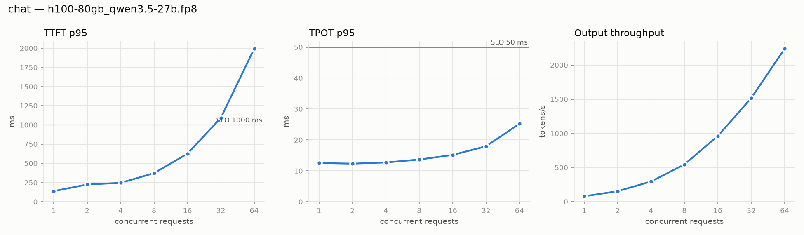

# Benchmark report — h100-80gb_qwen3.5-27b.fp8

- **GPU:** NVIDIA H100 80GB HBM3 · driver 595.112.07 · PCIe gen5 x16
- **Provider / price:** runpod · $4.39/h
- **Server:** http://127.0.0.1:8000 · model `Qwen/Qwen3.5-27B-FP8` · vLLM 0.32.0
- **Methodology:** 1.1 · loadgen 0.1.0 · repo 9b45fecfd4
- **Prompt calibration:** 1.000 tokens/word (tokenize)
- **Run:** 2026-11-26T06:10:43.481Z → 2026-11-26T06:30:42.955Z

## chat

512 → 256 tokens. SLO: TTFT p95 ≤ 1000 ms, TPOT p95 ≤ 50 ms, errors < 0.5%.

**Closed loop**

| Load | n | Errors | TTFT p50 / p95 / p99 (ms) | TPOT p50 / p95 (ms) | ITL p99 (ms) | Output tok/s | Req/s | Goodput req/s | SLO | Notes |
|---|---:|---:|---|---|---:|---:|---:|---:|:-:|---|
| c=1 | 30 | 0.0% | 131 / 138 / – | 12.1 / 12.5 | 13.3 | 79 | 0.31 | 0.31 | ✓ | p99 n/a (n=30) |
| c=2 | 56 | 0.0% | 198 / 224 / – | 12.3 / 12.3 | 13.3 | 154 | 0.61 | 0.61 | ✓ | p99 n/a (n=56) |
| c=4 | 101 | 0.0% | 236 / 245 / – | 12.7 / 12.7 | 14.1 | 295 | 1.15 | 1.15 | ✓ | p99 n/a (n=101) |
| c=8 | 197 | 0.0% | 356 / 372 / – | 13.3 / 13.6 | 14.9 | 546 | 2.18 | 2.18 | ✓ | p99 n/a (n=197) |
| c=16 | 315 | 0.0% | 595 / 625 / 630 | 14.4 / 15.1 | 16.3 | 962 | 3.89 | 3.89 | ✓ |  |
| c=32 | 331 | 0.0% | 886 / 1,092 / 1,098 | 17.2 / 17.9 | 21.7 | 1,519 | 6.12 | 3.29 | ✗ |  |
| c=64 | 363 | 0.0% | 1,489 / 1,996 / 2,026 | 22.3 / 25.2 | 48.4 | 2,239 | 9.88 | 2.18 | ✗ |  |

**Open loop (Poisson)**

| Load | n | Errors | TTFT p50 / p95 / p99 (ms) | TPOT p50 / p95 (ms) | ITL p99 (ms) | Output tok/s | Req/s | Goodput req/s | SLO | Notes |
|---|---:|---:|---|---|---:|---:|---:|---:|:-:|---|
| 2.071 req/s | 177 | 0.0% | 119 / 220 / – | 15.6 / 18.0 | 94.8 | 500 | 1.93 | 1.93 | ✓ | p99 n/a (n=177) |
| 4.141 req/s | 300 | 0.0% | 157 / 239 / 267 | 20.6 / 23.5 | 113.1 | 1,002 | 4.02 | 4.02 | ✓ |  |
| 6.212 req/s | 300 | 0.0% | 202 / 264 / 293 | 29.6 / 32.0 | 113.6 | 1,623 | 6.26 | 6.26 | ✓ |  |
| 7.455 req/s | 300 | 0.0% | 210 / 288 / 321 | 32.5 / 36.1 | 115.1 | 1,941 | 7.96 | 7.96 | ✓ |  |

- **Capacity (concurrency):** 16 concurrent requests · 962 output tok/s · $1.268 per 1M output tokens · $0.416 per 1M total tokens
- **Capacity (rate):** 7.46 req/s · 1,941 output tok/s · $0.628 per 1M output tokens · $0.212 per 1M total tokens

Cost assumes the GPU is fully used at the capacity point; setup and idle time are excluded (methodology §6). p99 is shown only with ≥ 300 samples; points where the load generator was the bottleneck are marked invalid and excluded from capacity.
