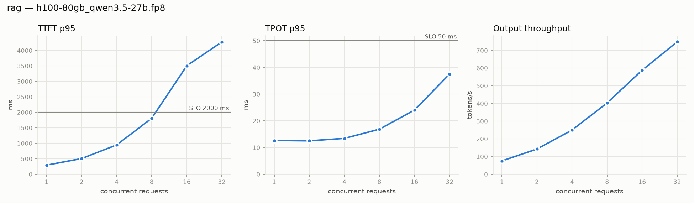

# Benchmark report — h100-80gb_qwen3.5-27b.fp8

- **GPU:** NVIDIA H100 80GB HBM3 · driver 595.112.07 · PCIe gen5 x16
- **Provider / price:** runpod · $4.39/h
- **Server:** http://127.0.0.1:8000 · model `Qwen/Qwen3.5-27B-FP8` · vLLM 0.32.0
- **Methodology:** 1.1 · loadgen 0.1.0 · repo 9b45fecfd4
- **Prompt calibration:** 1.000 tokens/word (tokenize)
- **Run:** 2026-11-26T13:09:40.218Z → 2026-11-26T13:32:20.358Z

## rag

4000 → 300 tokens. SLO: TTFT p95 ≤ 2000 ms, TPOT p95 ≤ 50 ms, errors < 0.5%.

**Closed loop**

| Load | n | Errors | TTFT p50 / p95 / p99 (ms) | TPOT p50 / p95 (ms) | ITL p99 (ms) | Output tok/s | Req/s | Goodput req/s | SLO | Notes |
|---|---:|---:|---|---|---:|---:|---:|---:|:-:|---|
| c=1 | 30 | 0.0% | 285 / 293 / – | 12.2 / 12.6 | 13.7 | 75 | 0.25 | 0.25 | ✓ | p99 n/a (n=30) |
| c=2 | 44 | 0.0% | 487 / 505 / – | 12.5 / 12.5 | 13.9 | 142 | 0.49 | 0.49 | ✓ | p99 n/a (n=44) |
| c=4 | 73 | 0.0% | 926 / 946 / – | 13.0 / 13.4 | 14.9 | 249 | 0.83 | 0.83 | ✓ | p99 n/a (n=73) |
| c=8 | 125 | 0.0% | 1,681 / 1,808 / – | 14.3 / 16.9 | 17.9 | 403 | 1.39 | 1.39 | ✓ | p99 n/a (n=125) |
| c=16 | 186 | 0.0% | 2,208 / 3,505 / – | 19.9 / 24.1 | 132.7 | 588 | 2.06 | 0.82 | ✗ | p99 n/a (n=186) |
| c=32 | 232 | 0.0% | 3,072 / 4,274 / – | 31.8 / 37.5 | 440.6 | 749 | 2.57 | 0.40 | ✗ | p99 n/a (n=232) |

**Open loop (Poisson)**

| Load | n | Errors | TTFT p50 / p95 / p99 (ms) | TPOT p50 / p95 (ms) | ITL p99 (ms) | Output tok/s | Req/s | Goodput req/s | SLO | Notes |
|---|---:|---:|---|---|---:|---:|---:|---:|:-:|---|
| 0.594 req/s | 53 | 0.0% | 304 / 525 / – | 15.1 / 17.4 | 115.3 | 185 | 0.61 | 0.61 | ✓ | p99 n/a (n=53) |
| 1.187 req/s | 115 | 0.0% | 307 / 734 / – | 19.2 / 23.1 | 129.1 | 383 | 1.27 | 1.27 | ✓ | p99 n/a (n=115) |
| 1.781 req/s | 147 | 0.0% | 388 / 899 / – | 22.1 / 32.5 | 146.9 | 511 | 1.78 | 1.78 | ✓ | p99 n/a (n=147) |
| 2.137 req/s | 185 | 0.0% | 434 / 885 / – | 31.8 / 39.6 | 219.9 | 644 | 2.19 | 2.19 | ✓ | p99 n/a (n=185) |

- **Capacity (concurrency):** 8 concurrent requests · 403 output tok/s · $3.028 per 1M output tokens · $0.211 per 1M total tokens
- **Capacity (rate):** 2.14 req/s · 644 output tok/s · $1.894 per 1M output tokens · $0.135 per 1M total tokens

Cost assumes the GPU is fully used at the capacity point; setup and idle time are excluded (methodology §6). p99 is shown only with ≥ 300 samples; points where the load generator was the bottleneck are marked invalid and excluded from capacity.
