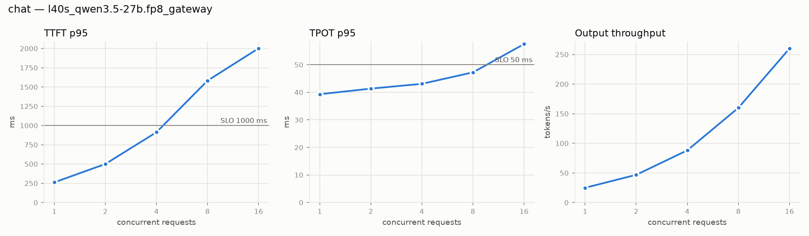

# Benchmark report — l40s_qwen3.5-27b.fp8_gateway

- **GPU:** NVIDIA L40S · driver 595.112.07 · PCIe gen4 x16
- **Provider / price:** runpod · $1.09/h
- **Server:** http://127.0.0.1:8000 · model `Qwen/Qwen3.5-27B-FP8` · vLLM 0.32.0
- **Methodology:** 1.1 · loadgen 0.1.0 · repo 9b45fecfd4
- **Prompt calibration:** 1.000 tokens/word (tokenize)
- **Run:** 2026-11-26T00:02:35.102Z → 2026-11-26T00:29:10.620Z

## chat

512 → 256 tokens. SLO: TTFT p95 ≤ 1000 ms, TPOT p95 ≤ 50 ms, errors < 0.5%.

**Closed loop**

| Load | n | Errors | TTFT p50 / p95 / p99 (ms) | TPOT p50 / p95 (ms) | ITL p99 (ms) | Output tok/s | Req/s | Goodput req/s | SLO | Notes |
|---|---:|---:|---|---|---:|---:|---:|---:|:-:|---|
| c=1 | 30 | 0.0% | 258 / 262 / – | 39.3 / 39.3 | 44.1 | 25 | 0.10 | 0.10 | ✓ | p99 n/a (n=30) |
| c=2 | 31 | 0.0% | 409 / 500 / – | 41.0 / 41.3 | 46.4 | 47 | 0.19 | 0.19 | ✓ | p99 n/a (n=31) |
| c=4 | 33 | 0.0% | 910 / 912 / – | 42.0 / 43.1 | 46.2 | 88 | 0.34 | 0.34 | ✓ | p99 n/a (n=33) |
| c=8 | 64 | 0.0% | 1,322 / 1,582 / – | 44.7 / 47.2 | 49.9 | 160 | 0.71 | 0.09 | ✗ | p99 n/a (n=64) |
| c=16 | 96 | 0.0% | 1,832 / 2,003 / – | 53.2 / 57.5 | 295.0 | 260 | 1.22 | 0.00 | ✗ | p99 n/a (n=96) |

**Open loop (Poisson)**

| Load | n | Errors | TTFT p50 / p95 / p99 (ms) | TPOT p50 / p95 (ms) | ITL p99 (ms) | Output tok/s | Req/s | Goodput req/s | SLO | Notes |
|---|---:|---:|---|---|---:|---:|---:|---:|:-:|---|
| 0.259 req/s | 32 | 0.0% | 323 / 484 / – | 44.9 / 47.4 | 165.2 | 92 | 0.36 | 0.36 | ✓ | p99 n/a (n=32) |
| 0.519 req/s | 46 | 0.0% | 330 / 499 / – | 48.4 / 55.4 | 170.6 | 136 | 0.59 | 0.39 | ✗ | p99 n/a (n=46) |
| 0.778 req/s | 80 | 0.0% | 338 / 514 / – | 54.6 / 61.3 | 173.7 | 223 | 0.82 | 0.06 | ✗ | p99 n/a (n=80) |
| 0.933 req/s | 80 | 0.0% | 337 / 546 / – | 57.4 / 61.2 | 175.9 | 222 | 0.88 | 0.13 | ✗ | p99 n/a (n=80) |

- **Capacity (concurrency):** 4 concurrent requests · 88 output tok/s · $3.437 per 1M output tokens · $1.128 per 1M total tokens
- **Capacity (rate):** 0.26 req/s · 92 output tok/s · $3.301 per 1M output tokens · $1.109 per 1M total tokens

Cost assumes the GPU is fully used at the capacity point; setup and idle time are excluded (methodology §6). p99 is shown only with ≥ 300 samples; points where the load generator was the bottleneck are marked invalid and excluded from capacity.
