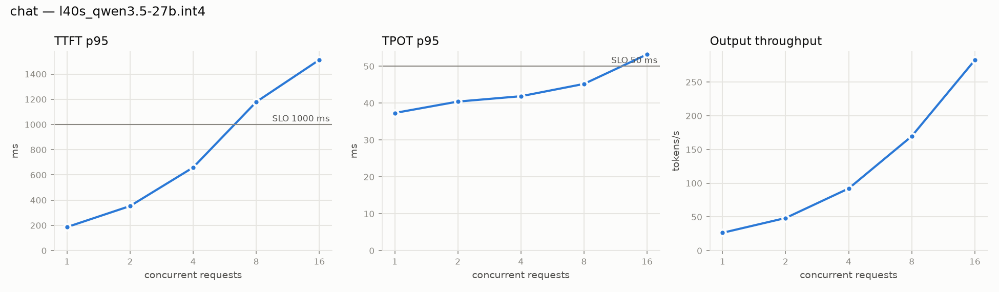
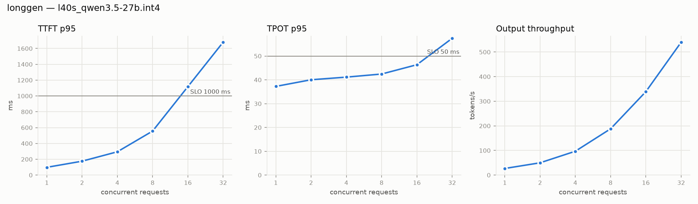
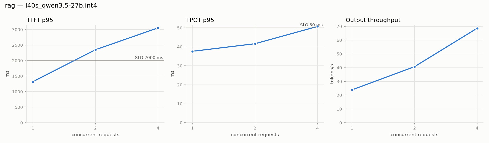

# Benchmark report — l40s_qwen3.5-27b.int4

- **GPU:** NVIDIA L40S · driver 595.112.07 · PCIe gen4 x16
- **Provider / price:** runpod · $1.09/h
- **Server:** http://127.0.0.1:8000 · model `Qwen/Qwen3.5-27B-GPTQ-Int4` · vLLM 0.32.0
- **Methodology:** 1.1 · loadgen 0.1.0 · repo 9b45fecfd4
- **Prompt calibration:** 1.000 tokens/word (tokenize)
- **Run:** 2026-11-26T00:37:40.969Z → 2026-11-26T02:30:05.826Z

## chat

512 → 256 tokens. SLO: TTFT p95 ≤ 1000 ms, TPOT p95 ≤ 50 ms, errors < 0.5%.

**Closed loop**

| Load | n | Errors | TTFT p50 / p95 / p99 (ms) | TPOT p50 / p95 (ms) | ITL p99 (ms) | Output tok/s | Req/s | Goodput req/s | SLO | Notes |
|---|---:|---:|---|---|---:|---:|---:|---:|:-:|---|
| c=1 | 30 | 0.0% | 183 / 187 / – | 37.3 / 37.3 | 41.9 | 26 | 0.10 | 0.10 | ✓ | p99 n/a (n=30) |
| c=2 | 31 | 0.0% | 289 / 353 / – | 40.2 / 40.4 | 44.2 | 48 | 0.20 | 0.20 | ✓ | p99 n/a (n=31) |
| c=4 | 36 | 0.0% | 654 / 659 / – | 41.0 / 41.9 | 45.4 | 92 | 0.40 | 0.40 | ✓ | p99 n/a (n=36) |
| c=8 | 64 | 0.0% | 945 / 1,179 / – | 43.4 / 45.2 | 48.4 | 170 | 0.76 | 0.47 | ✗ | p99 n/a (n=64) |
| c=16 | 109 | 0.0% | 1,349 / 1,513 / – | 50.7 / 53.2 | 251.8 | 283 | 1.25 | 0.00 | ✗ | p99 n/a (n=109) |

**Open loop (Poisson)**

| Load | n | Errors | TTFT p50 / p95 / p99 (ms) | TPOT p50 / p95 (ms) | ITL p99 (ms) | Output tok/s | Req/s | Goodput req/s | SLO | Notes |
|---|---:|---:|---|---|---:|---:|---:|---:|:-:|---|
| 0.272 req/s | 24 | 0.0% | 238 / 291 / – | 41.7 / 42.9 | 96.8 | 60 | 0.21 | 0.21 | ✓ | p99 n/a (n=24) |
| 0.544 req/s | 40 | 0.0% | 248 / 346 / – | 43.5 / 46.0 | 118.8 | 108 | 0.44 | 0.44 | ✓ | p99 n/a (n=40) |
| 0.817 req/s | 72 | 0.0% | 251 / 421 / – | 48.2 / 56.2 | 129.7 | 218 | 0.88 | 0.63 | ✗ | p99 n/a (n=72) |
| 0.98 req/s | 86 | 0.0% | 253 / 361 / – | 51.0 / 58.3 | 131.2 | 239 | 0.88 | 0.37 | ✗ | p99 n/a (n=86) |

- **Capacity (concurrency):** 4 concurrent requests · 92 output tok/s · $3.286 per 1M output tokens · $1.079 per 1M total tokens
- **Capacity (rate):** 0.54 req/s · 108 output tok/s · $2.797 per 1M output tokens · $0.897 per 1M total tokens

## longgen

200 → 1000 tokens. SLO: TTFT p95 ≤ 1000 ms, TPOT p95 ≤ 50 ms, errors < 0.5%.

**Closed loop**

| Load | n | Errors | TTFT p50 / p95 / p99 (ms) | TPOT p50 / p95 (ms) | ITL p99 (ms) | Output tok/s | Req/s | Goodput req/s | SLO | Notes |
|---|---:|---:|---|---|---:|---:|---:|---:|:-:|---|
| c=1 | 30 | 0.0% | 96 / 98 / – | 37.2 / 37.2 | 41.9 | 27 | 0.03 | 0.03 | ✓ | p99 n/a (n=30) |
| c=2 | 31 | 0.0% | 134 / 175 / – | 40.0 / 40.0 | 44.5 | 50 | 0.05 | 0.05 | ✓ | p99 n/a (n=31) |
| c=4 | 33 | 0.0% | 284 / 294 / – | 41.1 / 41.1 | 45.4 | 97 | 0.10 | 0.10 | ✓ | p99 n/a (n=33) |
| c=8 | 37 | 0.0% | 538 / 556 / – | 42.1 / 42.4 | 47.1 | 188 | 0.21 | 0.21 | ✓ | p99 n/a (n=37) |
| c=16 | 45 | 0.0% | 892 / 1,117 / – | 46.2 / 46.3 | 51.6 | 339 | 0.47 | 0.34 | ✗ | p99 n/a (n=45) |
| c=32 | 64 | 0.0% | 1,585 / 1,679 / – | 56.8 / 57.4 | 62.9 | 540 | 1.06 | 0.00 | ✗ | p99 n/a (n=64) |

**Open loop (Poisson)**

| Load | n | Errors | TTFT p50 / p95 / p99 (ms) | TPOT p50 / p95 (ms) | ITL p99 (ms) | Output tok/s | Req/s | Goodput req/s | SLO | Notes |
|---|---:|---:|---|---|---:|---:|---:|---:|:-:|---|
| 0.137 req/s | 11 | 0.0% | 162 / 173 / – | 41.1 / 41.2 | 48.0 | 123 | 0.11 | 0.11 | ✓ | p99 n/a (n=11) |
| 0.274 req/s | 25 | 0.0% | 161 / 208 / – | 44.6 / 45.1 | 66.0 | 283 | 0.23 | 0.23 | ✓ | p99 n/a (n=25) |
| 0.41 req/s | 37 | 0.0% | 181 / 227 / – | 50.8 / 51.8 | 78.2 | 382 | 0.28 | 0.08 | ✗ | p99 n/a (n=37) |
| 0.492 req/s | 39 | 0.0% | 169 / 206 / – | 49.0 / 51.1 | 75.8 | 293 | 0.23 | 0.17 | ✗ | p99 n/a (n=39) |

- **Capacity (concurrency):** 8 concurrent requests · 188 output tok/s · $1.611 per 1M output tokens · $1.329 per 1M total tokens
- **Capacity (rate):** 0.27 req/s · 283 output tok/s · $1.070 per 1M output tokens · $0.881 per 1M total tokens

## rag

4000 → 300 tokens. SLO: TTFT p95 ≤ 2000 ms, TPOT p95 ≤ 50 ms, errors < 0.5%.

**Closed loop**

| Load | n | Errors | TTFT p50 / p95 / p99 (ms) | TPOT p50 / p95 (ms) | ITL p99 (ms) | Output tok/s | Req/s | Goodput req/s | SLO | Notes |
|---|---:|---:|---|---|---:|---:|---:|---:|:-:|---|
| c=1 | 30 | 0.0% | 1,311 / 1,322 / – | 37.6 / 37.6 | 41.3 | 24 | 0.08 | 0.08 | ✓ | p99 n/a (n=30) |
| c=2 | 31 | 0.0% | 2,310 / 2,350 / – | 41.4 / 41.6 | 46.4 | 41 | 0.14 | 0.00 | ✗ | p99 n/a (n=31) |
| c=4 | 33 | 0.0% | 2,377 / 3,054 / – | 48.4 / 50.7 | 484.2 | 69 | 0.23 | 0.01 | ✗ | p99 n/a (n=33) |

**Open loop (Poisson)**

| Load | n | Errors | TTFT p50 / p95 / p99 (ms) | TPOT p50 / p95 (ms) | ITL p99 (ms) | Output tok/s | Req/s | Goodput req/s | SLO | Notes |
|---|---:|---:|---|---|---:|---:|---:|---:|:-:|---|
| 0.054 req/s | 6 | 0.0% | 2,224 / 2,480 / – | 41.7 / 47.2 | 47.2 | 16 | 0.06 | 0.02 | ✗ | p99 n/a (n=6) |
| 0.108 req/s | 12 | 0.0% | 1,370 / 2,771 / – | 45.2 / 51.4 | 258.3 | 34 | 0.09 | 0.06 | ✗ | p99 n/a (n=12) |
| 0.162 req/s | 9 | 0.0% | 1,366 / 1,566 / – | 44.0 / 51.5 | 256.3 | 32 | 0.11 | 0.10 | ✗ | p99 n/a (n=9) |
| 0.195 req/s | 25 | 0.0% | 2,081 / 3,140 / – | 60.9 / 75.4 | 504.1 | 87 | 0.30 | 0.01 | ✗ | p99 n/a (n=25) |

- **Capacity (concurrency):** 1 concurrent requests · 24 output tok/s · $12.678 per 1M output tokens · $0.882 per 1M total tokens
- **Capacity (rate):** – req/s · – output tok/s · $– per 1M output tokens · $– per 1M total tokens

Cost assumes the GPU is fully used at the capacity point; setup and idle time are excluded (methodology §6). p99 is shown only with ≥ 300 samples; points where the load generator was the bottleneck are marked invalid and excluded from capacity.
