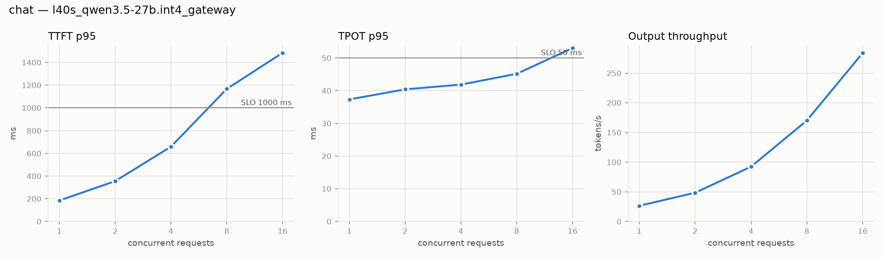

# Benchmark report — l40s_qwen3.5-27b.int4_gateway

- **GPU:** NVIDIA L40S · driver 595.112.07 · PCIe gen4 x16
- **Provider / price:** runpod · $1.09/h
- **Server:** http://127.0.0.1:8000 · model `Qwen/Qwen3.5-27B-GPTQ-Int4` · vLLM 0.32.0
- **Methodology:** 1.1 · loadgen 0.1.0 · repo 9b45fecfd4
- **Prompt calibration:** 1.000 tokens/word (tokenize)
- **Run:** 2026-11-26T02:30:08.469Z → 2026-11-26T02:56:25.759Z

## chat

512 → 256 tokens. SLO: TTFT p95 ≤ 1000 ms, TPOT p95 ≤ 50 ms, errors < 0.5%.

**Closed loop**

| Load | n | Errors | TTFT p50 / p95 / p99 (ms) | TPOT p50 / p95 (ms) | ITL p99 (ms) | Output tok/s | Req/s | Goodput req/s | SLO | Notes |
|---|---:|---:|---|---|---:|---:|---:|---:|:-:|---|
| c=1 | 30 | 0.0% | 181 / 184 / – | 37.3 / 37.3 | 42.3 | 26 | 0.10 | 0.10 | ✓ | p99 n/a (n=30) |
| c=2 | 31 | 0.0% | 292 / 354 / – | 40.2 / 40.4 | 45.3 | 48 | 0.19 | 0.19 | ✓ | p99 n/a (n=31) |
| c=4 | 36 | 0.0% | 650 / 658 / – | 41.0 / 41.9 | 46.2 | 92 | 0.39 | 0.39 | ✓ | p99 n/a (n=36) |
| c=8 | 64 | 0.0% | 937 / 1,167 / – | 43.4 / 45.2 | 50.4 | 170 | 0.75 | 0.47 | ✗ | p99 n/a (n=64) |
| c=16 | 109 | 0.0% | 1,324 / 1,485 / – | 50.5 / 53.0 | 245.3 | 284 | 1.24 | 0.00 | ✗ | p99 n/a (n=109) |

**Open loop (Poisson)**

| Load | n | Errors | TTFT p50 / p95 / p99 (ms) | TPOT p50 / p95 (ms) | ITL p99 (ms) | Output tok/s | Req/s | Goodput req/s | SLO | Notes |
|---|---:|---:|---|---|---:|---:|---:|---:|:-:|---|
| 0.273 req/s | 24 | 0.0% | 236 / 300 / – | 41.8 / 43.4 | 108.2 | 68 | 0.26 | 0.26 | ✓ | p99 n/a (n=24) |
| 0.547 req/s | 47 | 0.0% | 239 / 327 / – | 43.9 / 45.3 | 119.6 | 134 | 0.50 | 0.50 | ✓ | p99 n/a (n=47) |
| 0.82 req/s | 78 | 0.0% | 257 / 388 / – | 49.4 / 54.1 | 126.0 | 215 | 0.82 | 0.51 | ✗ | p99 n/a (n=78) |
| 0.984 req/s | 111 | 0.0% | 277 / 499 / – | 59.3 / 64.2 | 187.7 | 315 | 1.21 | 0.04 | ✗ | p99 n/a (n=111) |

- **Capacity (concurrency):** 4 concurrent requests · 92 output tok/s · $3.285 per 1M output tokens · $1.078 per 1M total tokens
- **Capacity (rate):** 0.55 req/s · 134 output tok/s · $2.258 per 1M output tokens · $0.742 per 1M total tokens

Cost assumes the GPU is fully used at the capacity point; setup and idle time are excluded (methodology §6). p99 is shown only with ≥ 300 samples; points where the load generator was the bottleneck are marked invalid and excluded from capacity.
