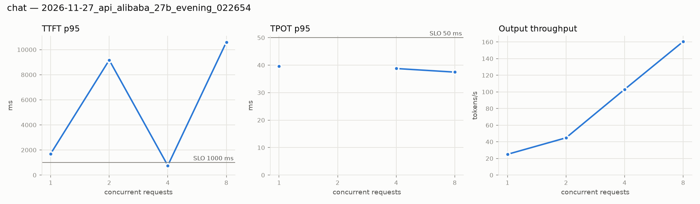
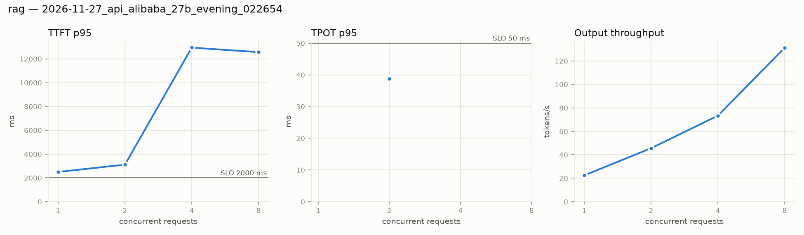

# Benchmark report — 2026-11-27_api_alibaba_27b_evening_022654

- **GPU:** none (local)
- **Provider / price:** – · price not set (GPU_PRICE_PER_HOUR_USD or --price)
- **Server:** https://openrouter.ai · model `qwen/qwen3.5-27b`
- **Methodology:** – · loadgen 0.1.0 · repo –
- **Prompt calibration:** 1.000 tokens/word (fixed)
- **Run:** 2026-11-27T02:26:54.779Z → 2026-11-27T02:52:55.111Z

## chat

512 → 256 tokens. SLO: TTFT p95 ≤ 1000 ms, TPOT p95 ≤ 50 ms, errors < 0.5%.

**Closed loop**

| Load | n | Errors | TTFT p50 / p95 / p99 (ms) | TPOT p50 / p95 (ms) | ITL p99 (ms) | Output tok/s | Req/s | Goodput req/s | SLO | Notes |
|---|---:|---:|---|---|---:|---:|---:|---:|:-:|---|
| c=1 | 30 | 0.0% | 613 / 1,699 / – | 36.2 / 39.6 | 420.9 | 25 | 0.10 | 0.09 | ✗ | p99 n/a (n=30) |
| c=2 | 31 | 3.2% | 613 / 9,168 / – | – / – | 424.8 | 45 | 0.18 | 0.14 | ✗ | p99 n/a (n=31); http_429 |
| c=4 | 33 | 0.0% | 604 / 758 / – | 36.0 / 38.8 | 428.5 | 103 | 0.41 | 0.41 | ✓ | p99 n/a (n=33) |
| c=8 | 42 | 0.0% | 612 / 10,599 / – | 35.3 / 37.5 | 438.0 | 160 | 0.75 | 0.48 | ✗ | p99 n/a (n=42) |

- **Capacity (concurrency):** 4 concurrent requests · 103 output tok/s · $– per 1M output tokens · $– per 1M total tokens

## rag

4000 → 300 tokens. SLO: TTFT p95 ≤ 2000 ms, TPOT p95 ≤ 50 ms, errors < 0.5%.

**Closed loop**

| Load | n | Errors | TTFT p50 / p95 / p99 (ms) | TPOT p50 / p95 (ms) | ITL p99 (ms) | Output tok/s | Req/s | Goodput req/s | SLO | Notes |
|---|---:|---:|---|---|---:|---:|---:|---:|:-:|---|
| c=1 | 30 | 3.3% | 2,215 / 2,496 / – | – / – | 430.0 | 22 | 0.08 | 0.00 | ✗ | p99 n/a (n=30); network:ECONNRESET |
| c=2 | 31 | 0.0% | 2,209 / 3,113 / – | 35.3 / 38.7 | 433.8 | 46 | 0.16 | 0.00 | ✗ | p99 n/a (n=31) |
| c=4 | 33 | 12.1% | 2,216 / 12,949 / – | – / – | 419.4 | 73 | 0.25 | 0.00 | ✗ | p99 n/a (n=33); network:ECONNRESET |
| c=8 | 37 | 8.1% | 5,231 / 12,569 / – | – / – | 424.6 | 131 | 0.46 | 0.00 | ✗ | p99 n/a (n=37); http_429 |

- **Capacity (concurrency):** – concurrent requests · – output tok/s · $– per 1M output tokens · $– per 1M total tokens

Cost assumes the GPU is fully used at the capacity point; setup and idle time are excluded (methodology §6). p99 is shown only with ≥ 300 samples; points where the load generator was the bottleneck are marked invalid and excluded from capacity.
