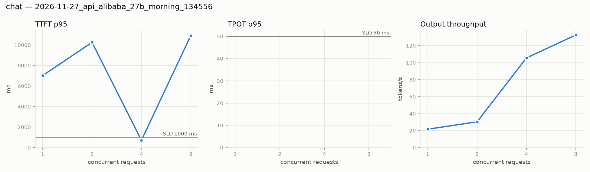
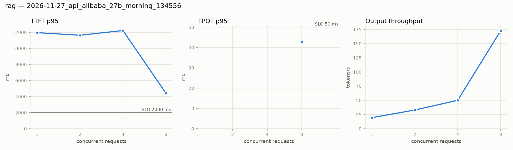

# Benchmark report — 2026-11-27_api_alibaba_27b_morning_134556

- **GPU:** none (local)
- **Provider / price:** – · price not set (GPU_PRICE_PER_HOUR_USD or --price)
- **Server:** https://openrouter.ai · model `qwen/qwen3.5-27b`
- **Methodology:** – · loadgen 0.1.0 · repo –
- **Prompt calibration:** 1.000 tokens/word (fixed)
- **Run:** 2026-11-27T13:45:58.087Z → 2026-11-27T14:12:08.401Z

## chat

512 → 256 tokens. SLO: TTFT p95 ≤ 1000 ms, TPOT p95 ≤ 50 ms, errors < 0.5%.

**Closed loop**

| Load | n | Errors | TTFT p50 / p95 / p99 (ms) | TPOT p50 / p95 (ms) | ITL p99 (ms) | Output tok/s | Req/s | Goodput req/s | SLO | Notes |
|---|---:|---:|---|---|---:|---:|---:|---:|:-:|---|
| c=1 | 30 | 16.7% | 624 / 7,025 / – | – / – | 422.4 | 22 | 0.08 | 0.08 | ✗ | p99 n/a (n=30); http_429 |
| c=2 | 31 | 25.8% | 629 / 10,256 / – | – / – | 427.4 | 30 | 0.12 | 0.09 | ✗ | p99 n/a (n=31); http_429 |
| c=4 | 33 | 3.0% | 618 / 708 / – | – / – | 430.1 | 106 | 0.43 | 0.41 | ✗ | p99 n/a (n=33); http_403 |
| c=8 | 40 | 12.5% | 2,193 / 10,921 / – | – / – | 424.9 | 133 | 0.60 | 0.29 | ✗ | p99 n/a (n=40); http_429 |

- **Capacity (concurrency):** – concurrent requests · – output tok/s · $– per 1M output tokens · $– per 1M total tokens

## rag

4000 → 300 tokens. SLO: TTFT p95 ≤ 2000 ms, TPOT p95 ≤ 50 ms, errors < 0.5%.

**Closed loop**

| Load | n | Errors | TTFT p50 / p95 / p99 (ms) | TPOT p50 / p95 (ms) | ITL p99 (ms) | Output tok/s | Req/s | Goodput req/s | SLO | Notes |
|---|---:|---:|---|---|---:|---:|---:|---:|:-:|---|
| c=1 | 30 | 10.0% | 2,250 / 11,948 / – | – / – | 429.2 | 20 | 0.07 | 0.00 | ✗ | p99 n/a (n=30); http_429 |
| c=2 | 31 | 29.0% | 2,239 / 11,629 / – | – / – | 404.4 | 33 | 0.12 | 0.00 | ✗ | p99 n/a (n=31); http_429 |
| c=4 | 33 | 45.5% | 2,272 / 12,214 / – | – / – | 411.7 | 50 | 0.15 | 0.00 | ✗ | p99 n/a (n=33); http_429 |
| c=8 | 39 | 0.0% | 2,238 / 4,430 / – | 35.3 / 42.7 | 426.9 | 173 | 0.67 | 0.00 | ✗ | p99 n/a (n=39) |

- **Capacity (concurrency):** – concurrent requests · – output tok/s · $– per 1M output tokens · $– per 1M total tokens

Cost assumes the GPU is fully used at the capacity point; setup and idle time are excluded (methodology §6). p99 is shown only with ≥ 300 samples; points where the load generator was the bottleneck are marked invalid and excluded from capacity.
