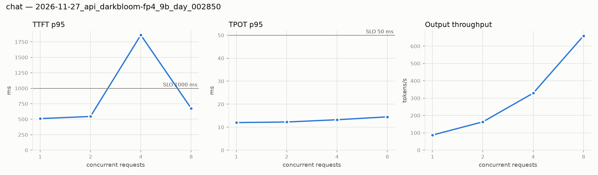
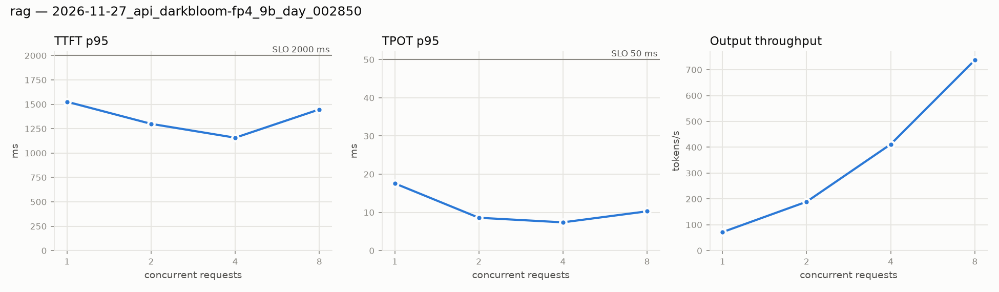

# Benchmark report — 2026-11-27_api_darkbloom-fp4_9b_day_002850

- **GPU:** none (local)
- **Provider / price:** – · price not set (GPU_PRICE_PER_HOUR_USD or --price)
- **Server:** https://openrouter.ai · model `qwen/qwen3.5-9b`
- **Methodology:** – · loadgen 0.1.0 · repo –
- **Prompt calibration:** 1.000 tokens/word (fixed)
- **Run:** 2026-11-27T00:28:50.287Z → 2026-11-27T00:38:14.818Z

## chat

512 → 256 tokens. SLO: TTFT p95 ≤ 1000 ms, TPOT p95 ≤ 50 ms, errors < 0.5%.

**Closed loop**

| Load | n | Errors | TTFT p50 / p95 / p99 (ms) | TPOT p50 / p95 (ms) | ITL p99 (ms) | Output tok/s | Req/s | Goodput req/s | SLO | Notes |
|---|---:|---:|---|---|---:|---:|---:|---:|:-:|---|
| c=1 | 30 | 0.0% | 362 / 511 / – | 10.3 / 12.0 | 135.0 | 87 | 0.34 | 0.34 | ✓ | p99 n/a (n=30) |
| c=2 | 40 | 0.0% | 370 / 545 / – | 10.4 / 12.3 | 163.7 | 164 | 0.65 | 0.65 | ✓ | p99 n/a (n=40) |
| c=4 | 63 | 0.0% | 382 / 1,861 / – | 10.1 / 13.2 | 136.8 | 329 | 1.31 | 1.23 | ✗ | p99 n/a (n=63) |
| c=8 | 67 | 0.0% | 384 / 676 / – | 10.3 / 14.5 | 162.6 | 660 | 2.68 | 2.60 | ✓ | p99 n/a (n=67) |

- **Capacity (concurrency):** 8 concurrent requests · 660 output tok/s · $– per 1M output tokens · $– per 1M total tokens

## rag

4000 → 300 tokens. SLO: TTFT p95 ≤ 2000 ms, TPOT p95 ≤ 50 ms, errors < 0.5%.

**Closed loop**

| Load | n | Errors | TTFT p50 / p95 / p99 (ms) | TPOT p50 / p95 (ms) | ITL p99 (ms) | Output tok/s | Req/s | Goodput req/s | SLO | Notes |
|---|---:|---:|---|---|---:|---:|---:|---:|:-:|---|
| c=1 | 30 | 0.0% | 1,288 / 1,526 / – | 8.7 / 17.6 | 127.0 | 71 | 0.24 | 0.23 | ✓ | p99 n/a (n=30) |
| c=2 | 39 | 0.0% | 899 / 1,300 / – | 6.7 / 8.6 | 98.9 | 189 | 0.64 | 0.62 | ✓ | p99 n/a (n=39) |
| c=4 | 63 | 0.0% | 868 / 1,158 / – | 6.6 / 7.4 | 90.1 | 412 | 1.37 | 1.35 | ✓ | p99 n/a (n=63) |
| c=8 | 67 | 0.0% | 968 / 1,448 / – | 6.6 / 10.3 | 118.4 | 737 | 2.53 | 2.53 | ✓ | p99 n/a (n=67) |

- **Capacity (concurrency):** 8 concurrent requests · 737 output tok/s · $– per 1M output tokens · $– per 1M total tokens

Cost assumes the GPU is fully used at the capacity point; setup and idle time are excluded (methodology §6). p99 is shown only with ≥ 300 samples; points where the load generator was the bottleneck are marked invalid and excluded from capacity.
