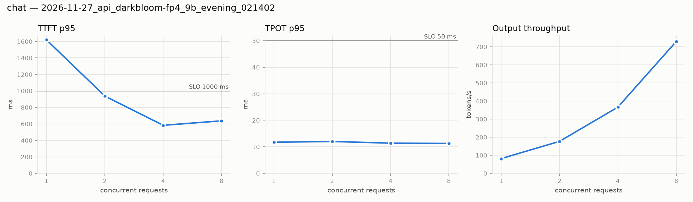
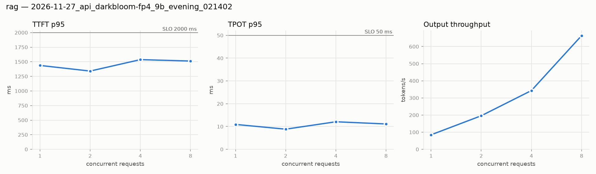

# Benchmark report — 2026-11-27_api_darkbloom-fp4_9b_evening_021402

- **GPU:** none (local)
- **Provider / price:** – · price not set (GPU_PRICE_PER_HOUR_USD or --price)
- **Server:** https://openrouter.ai · model `qwen/qwen3.5-9b`
- **Methodology:** – · loadgen 0.1.0 · repo –
- **Prompt calibration:** 1.000 tokens/word (fixed)
- **Run:** 2026-11-27T02:14:02.545Z → 2026-11-27T02:23:11.531Z

## chat

512 → 256 tokens. SLO: TTFT p95 ≤ 1000 ms, TPOT p95 ≤ 50 ms, errors < 0.5%.

**Closed loop**

| Load | n | Errors | TTFT p50 / p95 / p99 (ms) | TPOT p50 / p95 (ms) | ITL p99 (ms) | Output tok/s | Req/s | Goodput req/s | SLO | Notes |
|---|---:|---:|---|---|---:|---:|---:|---:|:-:|---|
| c=1 | 30 | 0.0% | 395 / 1,619 / – | 10.0 / 11.7 | 139.2 | 82 | 0.32 | 0.30 | ✗ | p99 n/a (n=30) |
| c=2 | 43 | 0.0% | 379 / 937 / – | 9.7 / 12.0 | 134.8 | 177 | 0.70 | 0.67 | ✓ | p99 n/a (n=43) |
| c=4 | 63 | 0.0% | 364 / 583 / – | 9.5 / 11.4 | 135.8 | 366 | 1.43 | 1.43 | ✓ | p99 n/a (n=63) |
| c=8 | 67 | 0.0% | 345 / 637 / – | 9.6 / 11.3 | 139.2 | 730 | 2.98 | 2.93 | ✓ | p99 n/a (n=67) |

- **Capacity (concurrency):** 8 concurrent requests · 730 output tok/s · $– per 1M output tokens · $– per 1M total tokens

## rag

4000 → 300 tokens. SLO: TTFT p95 ≤ 2000 ms, TPOT p95 ≤ 50 ms, errors < 0.5%.

**Closed loop**

| Load | n | Errors | TTFT p50 / p95 / p99 (ms) | TPOT p50 / p95 (ms) | ITL p99 (ms) | Output tok/s | Req/s | Goodput req/s | SLO | Notes |
|---|---:|---:|---|---|---:|---:|---:|---:|:-:|---|
| c=1 | 30 | 0.0% | 1,085 / 1,437 / – | 7.2 / 10.9 | 127.9 | 85 | 0.28 | 0.28 | ✓ | p99 n/a (n=30) |
| c=2 | 40 | 0.0% | 1,024 / 1,341 / – | 6.5 / 8.8 | 59.2 | 196 | 0.66 | 0.66 | ✓ | p99 n/a (n=40) |
| c=4 | 63 | 0.0% | 1,027 / 1,537 / – | 6.6 / 12.1 | 119.6 | 343 | 1.15 | 1.11 | ✓ | p99 n/a (n=63) |
| c=8 | 67 | 0.0% | 1,224 / 1,513 / – | 8.3 / 11.1 | 120.9 | 664 | 2.28 | 2.28 | ✓ | p99 n/a (n=67) |

- **Capacity (concurrency):** 8 concurrent requests · 664 output tok/s · $– per 1M output tokens · $– per 1M total tokens

Cost assumes the GPU is fully used at the capacity point; setup and idle time are excluded (methodology §6). p99 is shown only with ≥ 300 samples; points where the load generator was the bottleneck are marked invalid and excluded from capacity.
