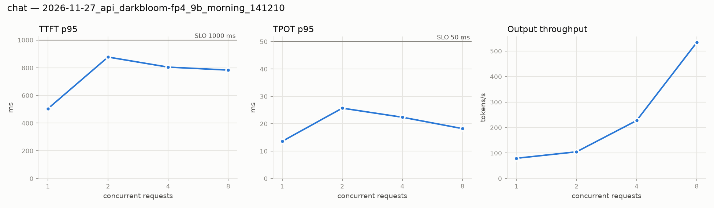
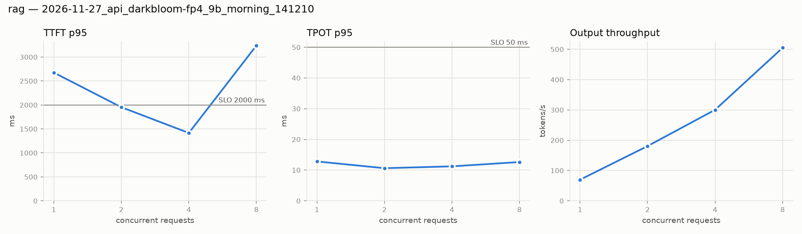

# Benchmark report — 2026-11-27_api_darkbloom-fp4_9b_morning_141210

- **GPU:** none (local)
- **Provider / price:** – · price not set (GPU_PRICE_PER_HOUR_USD or --price)
- **Server:** https://openrouter.ai · model `qwen/qwen3.5-9b`
- **Methodology:** – · loadgen 0.1.0 · repo –
- **Prompt calibration:** 1.000 tokens/word (fixed)
- **Run:** 2026-11-27T14:12:10.309Z → 2026-11-27T14:22:51.581Z

## chat

512 → 256 tokens. SLO: TTFT p95 ≤ 1000 ms, TPOT p95 ≤ 50 ms, errors < 0.5%.

**Closed loop**

| Load | n | Errors | TTFT p50 / p95 / p99 (ms) | TPOT p50 / p95 (ms) | ITL p99 (ms) | Output tok/s | Req/s | Goodput req/s | SLO | Notes |
|---|---:|---:|---|---|---:|---:|---:|---:|:-:|---|
| c=1 | 30 | 0.0% | 328 / 504 / – | 10.3 / 13.6 | 143.8 | 79 | 0.31 | 0.31 | ✓ | p99 n/a (n=30) |
| c=2 | 31 | 0.0% | 527 / 877 / – | 15.4 / 25.7 | 196.3 | 105 | 0.42 | 0.38 | ✓ | p99 n/a (n=31) |
| c=4 | 53 | 0.0% | 491 / 805 / – | 14.6 / 22.4 | 208.3 | 227 | 0.92 | 0.90 | ✓ | p99 n/a (n=53) |
| c=8 | 67 | 0.0% | 400 / 783 / – | 13.0 / 18.2 | 192.2 | 534 | 2.10 | 2.03 | ✓ | p99 n/a (n=67) |

- **Capacity (concurrency):** 8 concurrent requests · 534 output tok/s · $– per 1M output tokens · $– per 1M total tokens

## rag

4000 → 300 tokens. SLO: TTFT p95 ≤ 2000 ms, TPOT p95 ≤ 50 ms, errors < 0.5%.

**Closed loop**

| Load | n | Errors | TTFT p50 / p95 / p99 (ms) | TPOT p50 / p95 (ms) | ITL p99 (ms) | Output tok/s | Req/s | Goodput req/s | SLO | Notes |
|---|---:|---:|---|---|---:|---:|---:|---:|:-:|---|
| c=1 | 30 | 0.0% | 1,292 / 2,676 / – | 9.0 / 12.8 | 124.9 | 70 | 0.23 | 0.22 | ✗ | p99 n/a (n=30) |
| c=2 | 37 | 0.0% | 1,092 / 1,953 / – | 6.6 / 10.6 | 99.6 | 181 | 0.61 | 0.57 | ✓ | p99 n/a (n=37) |
| c=4 | 60 | 0.0% | 1,260 / 1,416 / – | 10.1 / 11.2 | 127.8 | 300 | 1.01 | 1.01 | ✓ | p99 n/a (n=60) |
| c=8 | 67 | 0.0% | 1,327 / 3,238 / – | 10.2 / 12.6 | 153.5 | 505 | 1.74 | 1.61 | ✗ | p99 n/a (n=67) |

- **Capacity (concurrency):** 4 concurrent requests · 300 output tok/s · $– per 1M output tokens · $– per 1M total tokens

Cost assumes the GPU is fully used at the capacity point; setup and idle time are excluded (methodology §6). p99 is shown only with ≥ 300 samples; points where the load generator was the bottleneck are marked invalid and excluded from capacity.
