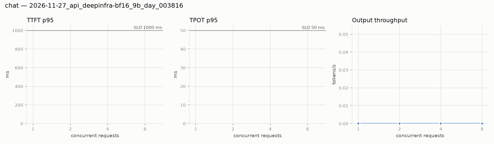

# Benchmark report — 2026-11-27_api_deepinfra-bf16_9b_day_003816

- **GPU:** none (local)
- **Provider / price:** – · price not set (GPU_PRICE_PER_HOUR_USD or --price)
- **Server:** https://openrouter.ai · model `qwen/qwen3.5-9b`
- **Methodology:** – · loadgen 0.1.0 · repo –
- **Prompt calibration:** 1.000 tokens/word (fixed)
- **Run:** 2026-11-27T00:38:17.092Z → 2026-11-27T00:39:21.945Z

## chat

512 → 256 tokens. SLO: TTFT p95 ≤ 1000 ms, TPOT p95 ≤ 50 ms, errors < 0.5%.

**Closed loop**

| Load | n | Errors | TTFT p50 / p95 / p99 (ms) | TPOT p50 / p95 (ms) | ITL p99 (ms) | Output tok/s | Req/s | Goodput req/s | SLO | Notes |
|---|---:|---:|---|---|---:|---:|---:|---:|:-:|---|
| c=1 | 60 | 100.0% | – / – / – | – / – | – | 0 | 0.00 | 0.00 | ✗ | p99 n/a (n=60); http_429 |
| c=2 | 61 | 100.0% | – / – / – | – / – | – | 0 | 0.00 | 0.00 | ✗ | p99 n/a (n=61); http_429 |
| c=4 | 63 | 100.0% | – / – / – | – / – | – | 0 | 0.00 | 0.00 | ✗ | p99 n/a (n=63); http_429 |
| c=8 | 67 | 100.0% | – / – / – | – / – | – | 0 | 0.00 | 0.00 | ✗ | p99 n/a (n=67); http_429 |

- **Capacity (concurrency):** – concurrent requests · – output tok/s · $– per 1M output tokens · $– per 1M total tokens

## rag

4000 → 300 tokens. SLO: TTFT p95 ≤ 2000 ms, TPOT p95 ≤ 50 ms, errors < 0.5%.

**Closed loop**

| Load | n | Errors | TTFT p50 / p95 / p99 (ms) | TPOT p50 / p95 (ms) | ITL p99 (ms) | Output tok/s | Req/s | Goodput req/s | SLO | Notes |
|---|---:|---:|---|---|---:|---:|---:|---:|:-:|---|
| c=1 | 60 | 100.0% | – / – / – | – / – | – | 0 | 0.00 | 0.00 | ✗ | p99 n/a (n=60); http_429 |
| c=2 | 61 | 100.0% | – / – / – | – / – | – | 0 | 0.00 | 0.00 | ✗ | p99 n/a (n=61); http_429 |
| c=4 | 63 | 100.0% | – / – / – | – / – | – | 0 | 0.00 | 0.00 | ✗ | p99 n/a (n=63); http_429 |
| c=8 | 67 | 100.0% | – / – / – | – / – | – | 0 | 0.00 | 0.00 | ✗ | p99 n/a (n=67); http_429 |

- **Capacity (concurrency):** – concurrent requests · – output tok/s · $– per 1M output tokens · $– per 1M total tokens

Cost assumes the GPU is fully used at the capacity point; setup and idle time are excluded (methodology §6). p99 is shown only with ≥ 300 samples; points where the load generator was the bottleneck are marked invalid and excluded from capacity.
