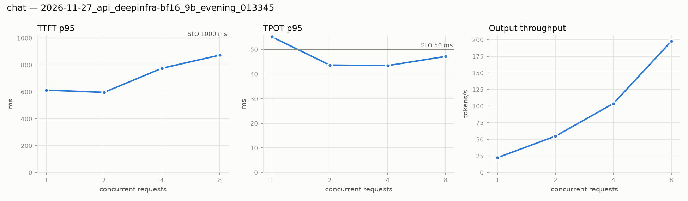
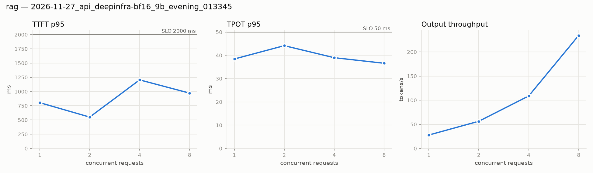

# Benchmark report — 2026-11-27_api_deepinfra-bf16_9b_evening_013345

- **GPU:** none (local)
- **Provider / price:** – · price not set (GPU_PRICE_PER_HOUR_USD or --price)
- **Server:** https://openrouter.ai · model `qwen/qwen3.5-9b`
- **Methodology:** – · loadgen 0.1.0 · repo –
- **Prompt calibration:** 1.000 tokens/word (fixed)
- **Run:** 2026-11-27T01:33:46.126Z → 2026-11-27T01:56:50.924Z

## chat

512 → 256 tokens. SLO: TTFT p95 ≤ 1000 ms, TPOT p95 ≤ 50 ms, errors < 0.5%.

**Closed loop**

| Load | n | Errors | TTFT p50 / p95 / p99 (ms) | TPOT p50 / p95 (ms) | ITL p99 (ms) | Output tok/s | Req/s | Goodput req/s | SLO | Notes |
|---|---:|---:|---|---|---:|---:|---:|---:|:-:|---|
| c=1 | 30 | 0.0% | 438 / 613 / – | 42.2 / 55.1 | 276.3 | 22 | 0.09 | 0.06 | ✗ | p99 n/a (n=30) |
| c=2 | 31 | 0.0% | 406 / 596 / – | 30.2 / 43.7 | 240.7 | 55 | 0.23 | 0.23 | ✓ | p99 n/a (n=31) |
| c=4 | 33 | 0.0% | 414 / 776 / – | 36.1 / 43.5 | 263.1 | 104 | 0.44 | 0.42 | ✓ | p99 n/a (n=33) |
| c=8 | 50 | 0.0% | 454 / 874 / – | 38.3 / 47.2 | 263.2 | 198 | 0.86 | 0.82 | ✓ | p99 n/a (n=50) |

- **Capacity (concurrency):** 8 concurrent requests · 198 output tok/s · $– per 1M output tokens · $– per 1M total tokens

## rag

4000 → 300 tokens. SLO: TTFT p95 ≤ 2000 ms, TPOT p95 ≤ 50 ms, errors < 0.5%.

**Closed loop**

| Load | n | Errors | TTFT p50 / p95 / p99 (ms) | TPOT p50 / p95 (ms) | ITL p99 (ms) | Output tok/s | Req/s | Goodput req/s | SLO | Notes |
|---|---:|---:|---|---|---:|---:|---:|---:|:-:|---|
| c=1 | 30 | 0.0% | 449 / 804 / – | 33.8 / 38.4 | 219.5 | 28 | 0.10 | 0.10 | ✓ | p99 n/a (n=30) |
| c=2 | 31 | 0.0% | 455 / 551 / – | 31.7 / 44.2 | 231.7 | 56 | 0.19 | 0.19 | ✓ | p99 n/a (n=31) |
| c=4 | 33 | 0.0% | 499 / 1,205 / – | 33.6 / 39.0 | 251.6 | 109 | 0.40 | 0.39 | ✓ | p99 n/a (n=33) |
| c=8 | 51 | 0.0% | 475 / 972 / – | 32.2 / 36.6 | 242.4 | 234 | 0.86 | 0.86 | ✓ | p99 n/a (n=51) |

- **Capacity (concurrency):** 8 concurrent requests · 234 output tok/s · $– per 1M output tokens · $– per 1M total tokens

Cost assumes the GPU is fully used at the capacity point; setup and idle time are excluded (methodology §6). p99 is shown only with ≥ 300 samples; points where the load generator was the bottleneck are marked invalid and excluded from capacity.
