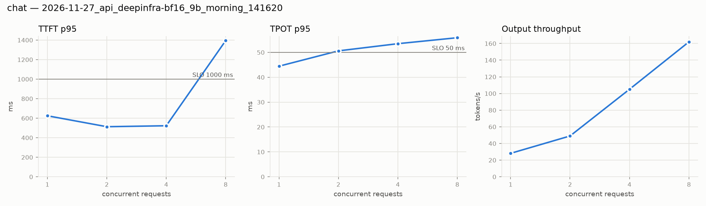
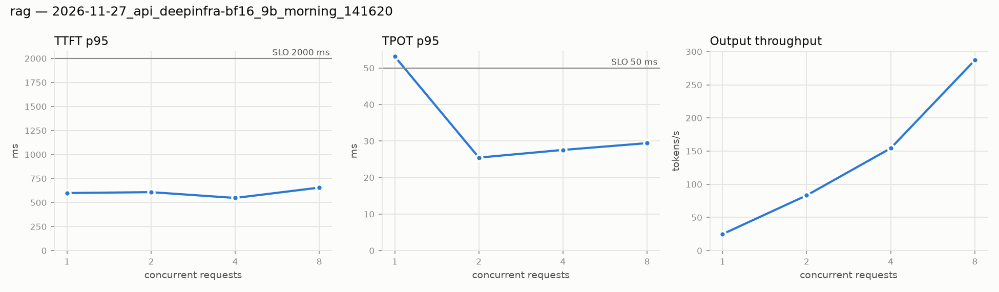

# Benchmark report — 2026-11-27_api_deepinfra-bf16_9b_morning_141620

- **GPU:** none (local)
- **Provider / price:** – · price not set (GPU_PRICE_PER_HOUR_USD or --price)
- **Server:** https://openrouter.ai · model `qwen/qwen3.5-9b`
- **Methodology:** – · loadgen 0.1.0 · repo –
- **Prompt calibration:** 1.000 tokens/word (fixed)
- **Run:** 2026-11-27T14:16:20.989Z → 2026-11-27T14:38:04.535Z

## chat

512 → 256 tokens. SLO: TTFT p95 ≤ 1000 ms, TPOT p95 ≤ 50 ms, errors < 0.5%.

**Closed loop**

| Load | n | Errors | TTFT p50 / p95 / p99 (ms) | TPOT p50 / p95 (ms) | ITL p99 (ms) | Output tok/s | Req/s | Goodput req/s | SLO | Notes |
|---|---:|---:|---|---|---:|---:|---:|---:|:-:|---|
| c=1 | 30 | 0.0% | 405 / 625 / – | 31.8 / 44.4 | 224.5 | 28 | 0.11 | 0.11 | ✓ | p99 n/a (n=30) |
| c=2 | 31 | 0.0% | 410 / 513 / – | 38.0 / 50.6 | 250.8 | 49 | 0.19 | 0.17 | ✗ | p99 n/a (n=31) |
| c=4 | 33 | 0.0% | 428 / 523 / – | 30.9 / 53.5 | 225.1 | 105 | 0.42 | 0.29 | ✗ | p99 n/a (n=33) |
| c=8 | 39 | 0.0% | 497 / 1,395 / – | 50.5 / 55.9 | 295.4 | 162 | 0.65 | 0.22 | ✗ | p99 n/a (n=39) |

- **Capacity (concurrency):** 1 concurrent requests · 28 output tok/s · $– per 1M output tokens · $– per 1M total tokens

## rag

4000 → 300 tokens. SLO: TTFT p95 ≤ 2000 ms, TPOT p95 ≤ 50 ms, errors < 0.5%.

**Closed loop**

| Load | n | Errors | TTFT p50 / p95 / p99 (ms) | TPOT p50 / p95 (ms) | ITL p99 (ms) | Output tok/s | Req/s | Goodput req/s | SLO | Notes |
|---|---:|---:|---|---|---:|---:|---:|---:|:-:|---|
| c=1 | 30 | 0.0% | 491 / 599 / – | 39.1 / 53.1 | 244.0 | 25 | 0.08 | 0.07 | ✗ | p99 n/a (n=30) |
| c=2 | 31 | 0.0% | 410 / 608 / – | 22.4 / 25.5 | 149.6 | 83 | 0.29 | 0.29 | ✓ | p99 n/a (n=31) |
| c=4 | 33 | 0.0% | 434 / 548 / – | 24.9 / 27.6 | 173.4 | 154 | 0.52 | 0.52 | ✓ | p99 n/a (n=33) |
| c=8 | 61 | 0.0% | 504 / 656 / – | 25.6 / 29.4 | 173.9 | 287 | 1.05 | 1.05 | ✓ | p99 n/a (n=61) |

- **Capacity (concurrency):** 8 concurrent requests · 287 output tok/s · $– per 1M output tokens · $– per 1M total tokens

Cost assumes the GPU is fully used at the capacity point; setup and idle time are excluded (methodology §6). p99 is shown only with ≥ 300 samples; points where the load generator was the bottleneck are marked invalid and excluded from capacity.
