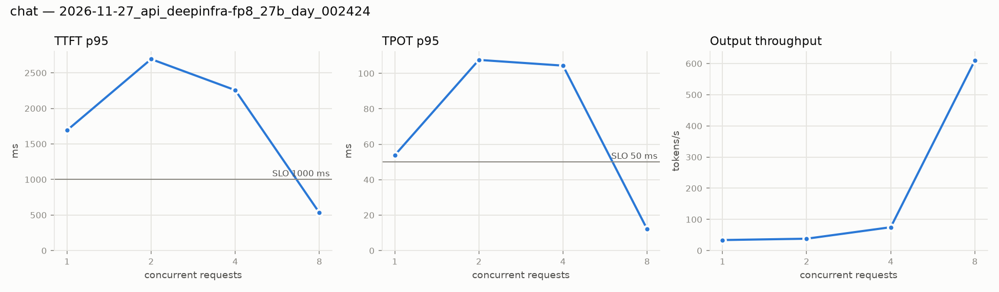
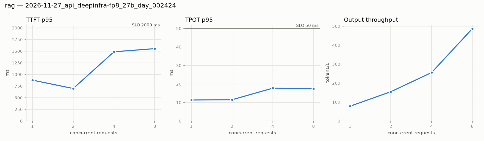

# Benchmark report — 2026-11-27_api_deepinfra-fp8_27b_day_002424

- **GPU:** none (local)
- **Provider / price:** – · price not set (GPU_PRICE_PER_HOUR_USD or --price)
- **Server:** https://openrouter.ai · model `qwen/qwen3.5-27b`
- **Methodology:** – · loadgen 0.1.0 · repo –
- **Prompt calibration:** 1.000 tokens/word (fixed)
- **Run:** 2026-11-27T00:24:24.307Z → 2026-11-27T00:40:34.366Z

## chat

512 → 256 tokens. SLO: TTFT p95 ≤ 1000 ms, TPOT p95 ≤ 50 ms, errors < 0.5%.

**Closed loop**

| Load | n | Errors | TTFT p50 / p95 / p99 (ms) | TPOT p50 / p95 (ms) | ITL p99 (ms) | Output tok/s | Req/s | Goodput req/s | SLO | Notes |
|---|---:|---:|---|---|---:|---:|---:|---:|:-:|---|
| c=1 | 30 | 0.0% | 381 / 1,691 / – | 22.8 / 53.8 | 389.2 | 34 | 0.13 | 0.11 | ✗ | p99 n/a (n=30) |
| c=2 | 31 | 0.0% | 384 / 2,693 / – | 45.2 / 107.6 | 1,128.0 | 38 | 0.15 | 0.07 | ✗ | p99 n/a (n=31) |
| c=4 | 33 | 0.0% | 384 / 2,257 / – | 41.8 / 104.4 | 1,164.8 | 75 | 0.30 | 0.18 | ✗ | p99 n/a (n=33) |
| c=8 | 67 | 0.0% | 354 / 532 / – | 11.3 / 12.1 | 51.2 | 610 | 2.43 | 2.43 | ✓ | p99 n/a (n=67) |

- **Capacity (concurrency):** 8 concurrent requests · 610 output tok/s · $– per 1M output tokens · $– per 1M total tokens

## rag

4000 → 300 tokens. SLO: TTFT p95 ≤ 2000 ms, TPOT p95 ≤ 50 ms, errors < 0.5%.

**Closed loop**

| Load | n | Errors | TTFT p50 / p95 / p99 (ms) | TPOT p50 / p95 (ms) | ITL p99 (ms) | Output tok/s | Req/s | Goodput req/s | SLO | Notes |
|---|---:|---:|---|---|---:|---:|---:|---:|:-:|---|
| c=1 | 30 | 0.0% | 698 / 877 / – | 10.2 / 11.3 | 49.5 | 78 | 0.27 | 0.27 | ✓ | p99 n/a (n=30) |
| c=2 | 32 | 0.0% | 594 / 698 / – | 11.0 / 11.5 | 49.8 | 154 | 0.53 | 0.53 | ✓ | p99 n/a (n=32) |
| c=4 | 53 | 0.0% | 720 / 1,486 / – | 11.9 / 17.7 | 59.0 | 255 | 0.88 | 0.85 | ✓ | p99 n/a (n=53) |
| c=8 | 67 | 0.0% | 1,028 / 1,554 / – | 12.6 / 17.4 | 63.8 | 487 | 1.67 | 1.67 | ✓ | p99 n/a (n=67) |

- **Capacity (concurrency):** 8 concurrent requests · 487 output tok/s · $– per 1M output tokens · $– per 1M total tokens

Cost assumes the GPU is fully used at the capacity point; setup and idle time are excluded (methodology §6). p99 is shown only with ≥ 300 samples; points where the load generator was the bottleneck are marked invalid and excluded from capacity.
