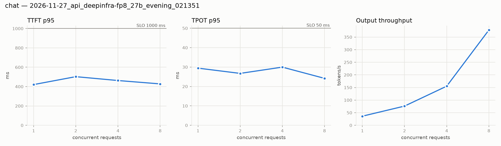
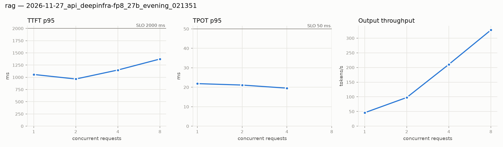

# Benchmark report — 2026-11-27_api_deepinfra-fp8_27b_evening_021351

- **GPU:** none (local)
- **Provider / price:** – · price not set (GPU_PRICE_PER_HOUR_USD or --price)
- **Server:** https://openrouter.ai · model `qwen/qwen3.5-27b`
- **Methodology:** – · loadgen 0.1.0 · repo –
- **Prompt calibration:** 1.000 tokens/word (fixed)
- **Run:** 2026-11-27T02:13:51.806Z → 2026-11-27T02:29:00.848Z

## chat

512 → 256 tokens. SLO: TTFT p95 ≤ 1000 ms, TPOT p95 ≤ 50 ms, errors < 0.5%.

**Closed loop**

| Load | n | Errors | TTFT p50 / p95 / p99 (ms) | TPOT p50 / p95 (ms) | ITL p99 (ms) | Output tok/s | Req/s | Goodput req/s | SLO | Notes |
|---|---:|---:|---|---|---:|---:|---:|---:|:-:|---|
| c=1 | 30 | 0.0% | 322 / 421 / – | 25.8 / 29.4 | 118.7 | 36 | 0.14 | 0.14 | ✓ | p99 n/a (n=30) |
| c=2 | 31 | 0.0% | 329 / 503 / – | 25.0 / 26.7 | 109.6 | 76 | 0.31 | 0.31 | ✓ | p99 n/a (n=31) |
| c=4 | 37 | 0.0% | 325 / 463 / – | 24.7 / 30.0 | 117.7 | 155 | 0.63 | 0.63 | ✓ | p99 n/a (n=37) |
| c=8 | 67 | 0.0% | 315 / 428 / – | 17.9 / 24.2 | 128.7 | 378 | 1.50 | 1.50 | ✓ | p99 n/a (n=67) |

- **Capacity (concurrency):** 8 concurrent requests · 378 output tok/s · $– per 1M output tokens · $– per 1M total tokens

## rag

4000 → 300 tokens. SLO: TTFT p95 ≤ 2000 ms, TPOT p95 ≤ 50 ms, errors < 0.5%.

**Closed loop**

| Load | n | Errors | TTFT p50 / p95 / p99 (ms) | TPOT p50 / p95 (ms) | ITL p99 (ms) | Output tok/s | Req/s | Goodput req/s | SLO | Notes |
|---|---:|---:|---|---|---:|---:|---:|---:|:-:|---|
| c=1 | 30 | 0.0% | 658 / 1,058 / – | 18.2 / 21.9 | 137.7 | 46 | 0.15 | 0.15 | ✓ | p99 n/a (n=30) |
| c=2 | 31 | 0.0% | 652 / 965 / – | 17.4 / 21.1 | 96.8 | 98 | 0.33 | 0.33 | ✓ | p99 n/a (n=31) |
| c=4 | 43 | 0.0% | 840 / 1,149 / – | 15.6 / 19.5 | 68.0 | 210 | 0.74 | 0.74 | ✓ | p99 n/a (n=43) |
| c=8 | 67 | 11.9% | 890 / 1,374 / – | – / – | 101.0 | 328 | 1.18 | 1.18 | ✗ | p99 n/a (n=67); network:ECONNRESET |

- **Capacity (concurrency):** 4 concurrent requests · 210 output tok/s · $– per 1M output tokens · $– per 1M total tokens

Cost assumes the GPU is fully used at the capacity point; setup and idle time are excluded (methodology §6). p99 is shown only with ≥ 300 samples; points where the load generator was the bottleneck are marked invalid and excluded from capacity.
