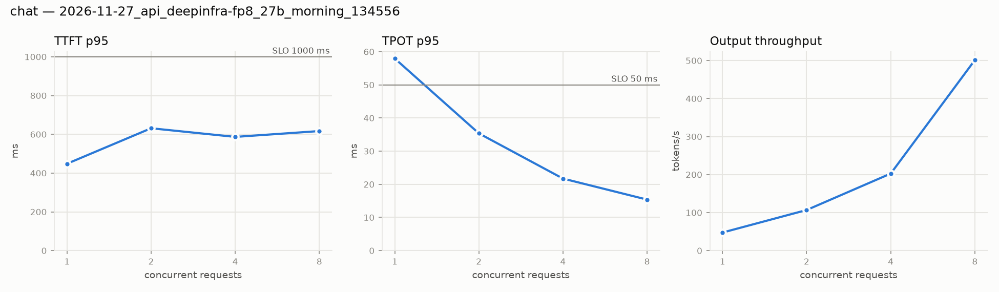
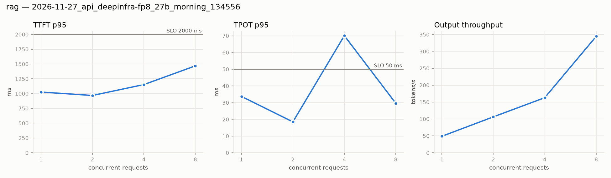

# Benchmark report — 2026-11-27_api_deepinfra-fp8_27b_morning_134556

- **GPU:** none (local)
- **Provider / price:** – · price not set (GPU_PRICE_PER_HOUR_USD or --price)
- **Server:** https://openrouter.ai · model `qwen/qwen3.5-27b`
- **Methodology:** – · loadgen 0.1.0 · repo –
- **Prompt calibration:** 1.000 tokens/word (fixed)
- **Run:** 2026-11-27T13:45:58.094Z → 2026-11-27T13:59:21.806Z

## chat

512 → 256 tokens. SLO: TTFT p95 ≤ 1000 ms, TPOT p95 ≤ 50 ms, errors < 0.5%.

**Closed loop**

| Load | n | Errors | TTFT p50 / p95 / p99 (ms) | TPOT p50 / p95 (ms) | ITL p99 (ms) | Output tok/s | Req/s | Goodput req/s | SLO | Notes |
|---|---:|---:|---|---|---:|---:|---:|---:|:-:|---|
| c=1 | 30 | 0.0% | 296 / 448 / – | 15.6 / 58.0 | 92.3 | 47 | 0.19 | 0.17 | ✗ | p99 n/a (n=30) |
| c=2 | 31 | 0.0% | 362 / 631 / – | 14.3 / 35.4 | 100.0 | 107 | 0.43 | 0.40 | ✓ | p99 n/a (n=31) |
| c=4 | 47 | 0.0% | 321 / 587 / – | 15.3 / 21.7 | 113.7 | 203 | 0.81 | 0.81 | ✓ | p99 n/a (n=47) |
| c=8 | 67 | 0.0% | 361 / 617 / – | 14.4 / 15.4 | 65.3 | 501 | 2.02 | 2.02 | ✓ | p99 n/a (n=67) |

- **Capacity (concurrency):** 8 concurrent requests · 501 output tok/s · $– per 1M output tokens · $– per 1M total tokens

## rag

4000 → 300 tokens. SLO: TTFT p95 ≤ 2000 ms, TPOT p95 ≤ 50 ms, errors < 0.5%.

**Closed loop**

| Load | n | Errors | TTFT p50 / p95 / p99 (ms) | TPOT p50 / p95 (ms) | ITL p99 (ms) | Output tok/s | Req/s | Goodput req/s | SLO | Notes |
|---|---:|---:|---|---|---:|---:|---:|---:|:-:|---|
| c=1 | 30 | 0.0% | 682 / 1,026 / – | 15.7 / 33.7 | 92.9 | 49 | 0.16 | 0.16 | ✓ | p99 n/a (n=30) |
| c=2 | 31 | 0.0% | 671 / 968 / – | 16.5 / 18.5 | 93.2 | 106 | 0.37 | 0.37 | ✓ | p99 n/a (n=31) |
| c=4 | 34 | 0.0% | 877 / 1,152 / – | 15.7 / 70.1 | 135.9 | 163 | 0.55 | 0.50 | ✗ | p99 n/a (n=34) |
| c=8 | 67 | 0.0% | 1,220 / 1,468 / – | 18.6 / 29.6 | 101.4 | 344 | 1.20 | 1.20 | ✓ | p99 n/a (n=67) |

- **Capacity (concurrency):** 8 concurrent requests · 344 output tok/s · $– per 1M output tokens · $– per 1M total tokens

Cost assumes the GPU is fully used at the capacity point; setup and idle time are excluded (methodology §6). p99 is shown only with ≥ 300 samples; points where the load generator was the bottleneck are marked invalid and excluded from capacity.
