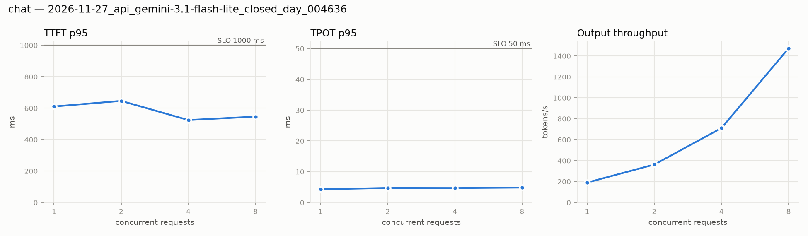
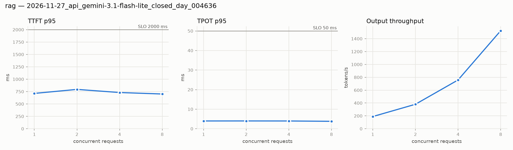

# Benchmark report — 2026-11-27_api_gemini-3.1-flash-lite_closed_day_004636

- **GPU:** none (local)
- **Provider / price:** – · price not set (GPU_PRICE_PER_HOUR_USD or --price)
- **Server:** https://openrouter.ai · model `google/gemini-3.1-flash-lite`
- **Methodology:** – · loadgen 0.1.0 · repo –
- **Prompt calibration:** 1.000 tokens/word (fixed)
- **Run:** 2026-11-27T00:46:36.677Z → 2026-11-27T00:52:03.014Z

## chat

512 → 256 tokens. SLO: TTFT p95 ≤ 1000 ms, TPOT p95 ≤ 50 ms, errors < 0.5%.

**Closed loop**

| Load | n | Errors | TTFT p50 / p95 / p99 (ms) | TPOT p50 / p95 (ms) | ITL p99 (ms) | Output tok/s | Req/s | Goodput req/s | SLO | Notes |
|---|---:|---:|---|---|---:|---:|---:|---:|:-:|---|
| c=1 | 46 | 0.0% | 358 / 611 / – | 3.8 / 4.3 | 258.5 | 191 | 0.77 | 0.77 | ✓ | p99 n/a (n=46) |
| c=2 | 61 | 0.0% | 381 / 646 / – | 3.9 / 4.7 | 294.8 | 363 | 1.46 | 1.46 | ✓ | p99 n/a (n=61) |
| c=4 | 63 | 0.0% | 396 / 525 / – | 3.9 / 4.7 | 287.7 | 711 | 2.83 | 2.78 | ✓ | p99 n/a (n=63) |
| c=8 | 67 | 0.0% | 370 / 547 / – | 3.9 / 4.9 | 312.1 | 1,474 | 5.97 | 5.97 | ✓ | p99 n/a (n=67) |

- **Capacity (concurrency):** 8 concurrent requests · 1,474 output tok/s · $– per 1M output tokens · $– per 1M total tokens

## rag

4000 → 300 tokens. SLO: TTFT p95 ≤ 2000 ms, TPOT p95 ≤ 50 ms, errors < 0.5%.

**Closed loop**

| Load | n | Errors | TTFT p50 / p95 / p99 (ms) | TPOT p50 / p95 (ms) | ITL p99 (ms) | Output tok/s | Req/s | Goodput req/s | SLO | Notes |
|---|---:|---:|---|---|---:|---:|---:|---:|:-:|---|
| c=1 | 39 | 0.0% | 576 / 713 / – | 3.2 / 4.0 | 268.7 | 189 | 0.64 | 0.64 | ✓ | p99 n/a (n=39) |
| c=2 | 61 | 0.0% | 572 / 794 / – | 3.2 / 4.0 | 226.8 | 380 | 1.29 | 1.29 | ✓ | p99 n/a (n=61) |
| c=4 | 63 | 0.0% | 565 / 731 / – | 3.3 / 4.0 | 269.6 | 758 | 2.54 | 2.54 | ✓ | p99 n/a (n=63) |
| c=8 | 67 | 0.0% | 557 / 701 / – | 3.2 / 3.8 | 284.2 | 1,524 | 5.41 | 5.41 | ✓ | p99 n/a (n=67) |

- **Capacity (concurrency):** 8 concurrent requests · 1,524 output tok/s · $– per 1M output tokens · $– per 1M total tokens

Cost assumes the GPU is fully used at the capacity point; setup and idle time are excluded (methodology §6). p99 is shown only with ≥ 300 samples; points where the load generator was the bottleneck are marked invalid and excluded from capacity.
