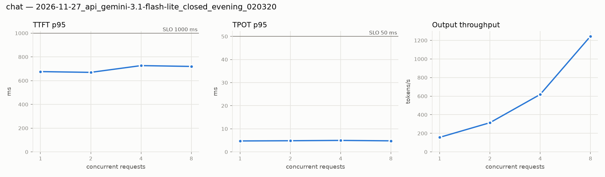
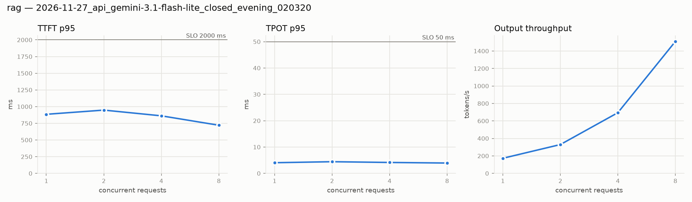

# Benchmark report — 2026-11-27_api_gemini-3.1-flash-lite_closed_evening_020320

- **GPU:** none (local)
- **Provider / price:** – · price not set (GPU_PRICE_PER_HOUR_USD or --price)
- **Server:** https://openrouter.ai · model `google/gemini-3.1-flash-lite`
- **Methodology:** – · loadgen 0.1.0 · repo –
- **Prompt calibration:** 1.000 tokens/word (fixed)
- **Run:** 2026-11-27T02:03:20.417Z → 2026-11-27T02:09:10.626Z

## chat

512 → 256 tokens. SLO: TTFT p95 ≤ 1000 ms, TPOT p95 ≤ 50 ms, errors < 0.5%.

**Closed loop**

| Load | n | Errors | TTFT p50 / p95 / p99 (ms) | TPOT p50 / p95 (ms) | ITL p99 (ms) | Output tok/s | Req/s | Goodput req/s | SLO | Notes |
|---|---:|---:|---|---|---:|---:|---:|---:|:-:|---|
| c=1 | 38 | 0.0% | 550 / 676 / – | 4.3 / 4.7 | 307.3 | 156 | 0.64 | 0.64 | ✓ | p99 n/a (n=38) |
| c=2 | 61 | 0.0% | 550 / 670 / – | 4.3 / 4.8 | 254.1 | 314 | 1.27 | 1.25 | ✓ | p99 n/a (n=61) |
| c=4 | 63 | 0.0% | 528 / 727 / – | 4.3 / 5.0 | 268.4 | 618 | 2.43 | 2.43 | ✓ | p99 n/a (n=63) |
| c=8 | 67 | 0.0% | 552 / 720 / – | 4.3 / 4.8 | 173.8 | 1,244 | 5.07 | 4.99 | ✓ | p99 n/a (n=67) |

- **Capacity (concurrency):** 8 concurrent requests · 1,244 output tok/s · $– per 1M output tokens · $– per 1M total tokens

## rag

4000 → 300 tokens. SLO: TTFT p95 ≤ 2000 ms, TPOT p95 ≤ 50 ms, errors < 0.5%.

**Closed loop**

| Load | n | Errors | TTFT p50 / p95 / p99 (ms) | TPOT p50 / p95 (ms) | ITL p99 (ms) | Output tok/s | Req/s | Goodput req/s | SLO | Notes |
|---|---:|---:|---|---|---:|---:|---:|---:|:-:|---|
| c=1 | 35 | 0.0% | 689 / 885 / – | 3.4 / 4.0 | 248.7 | 172 | 0.58 | 0.58 | ✓ | p99 n/a (n=35) |
| c=2 | 61 | 0.0% | 706 / 948 / – | 3.6 / 4.4 | 259.3 | 329 | 1.12 | 1.12 | ✓ | p99 n/a (n=61) |
| c=4 | 63 | 0.0% | 626 / 862 / – | 3.5 / 4.1 | 280.2 | 694 | 2.33 | 2.33 | ✓ | p99 n/a (n=63) |
| c=8 | 67 | 0.0% | 559 / 721 / – | 3.3 / 3.9 | 260.4 | 1,509 | 5.19 | 5.19 | ✓ | p99 n/a (n=67) |

- **Capacity (concurrency):** 8 concurrent requests · 1,509 output tok/s · $– per 1M output tokens · $– per 1M total tokens

Cost assumes the GPU is fully used at the capacity point; setup and idle time are excluded (methodology §6). p99 is shown only with ≥ 300 samples; points where the load generator was the bottleneck are marked invalid and excluded from capacity.
