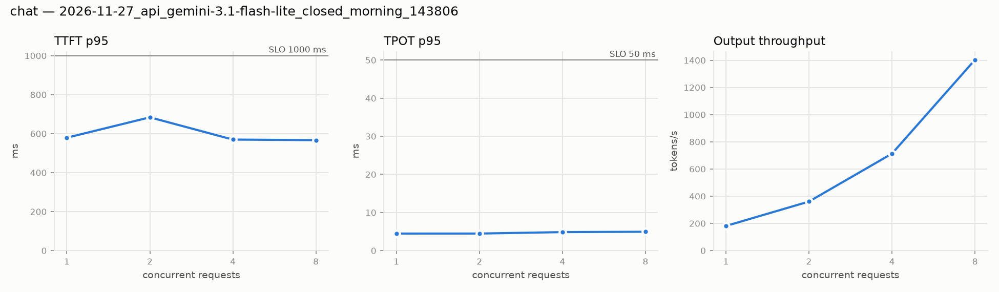
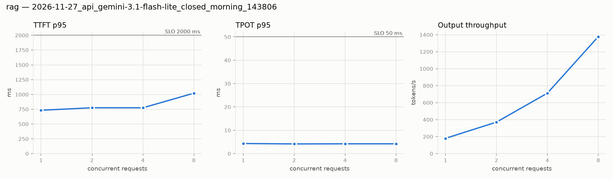

# Benchmark report — 2026-11-27_api_gemini-3.1-flash-lite_closed_morning_143806

- **GPU:** none (local)
- **Provider / price:** – · price not set (GPU_PRICE_PER_HOUR_USD or --price)
- **Server:** https://openrouter.ai · model `google/gemini-3.1-flash-lite`
- **Methodology:** – · loadgen 0.1.0 · repo –
- **Prompt calibration:** 1.000 tokens/word (fixed)
- **Run:** 2026-11-27T14:38:06.654Z → 2026-11-27T14:43:38.697Z

## chat

512 → 256 tokens. SLO: TTFT p95 ≤ 1000 ms, TPOT p95 ≤ 50 ms, errors < 0.5%.

**Closed loop**

| Load | n | Errors | TTFT p50 / p95 / p99 (ms) | TPOT p50 / p95 (ms) | ITL p99 (ms) | Output tok/s | Req/s | Goodput req/s | SLO | Notes |
|---|---:|---:|---|---|---:|---:|---:|---:|:-:|---|
| c=1 | 44 | 0.0% | 409 / 579 / – | 3.9 / 4.5 | 366.6 | 181 | 0.74 | 0.74 | ✓ | p99 n/a (n=44) |
| c=2 | 61 | 0.0% | 416 / 684 / – | 3.8 / 4.5 | 304.1 | 361 | 1.45 | 1.43 | ✓ | p99 n/a (n=61) |
| c=4 | 63 | 0.0% | 390 / 570 / – | 4.0 / 4.9 | 306.2 | 713 | 2.81 | 2.81 | ✓ | p99 n/a (n=63) |
| c=8 | 67 | 0.0% | 412 / 567 / – | 4.0 / 4.9 | 309.1 | 1,404 | 5.62 | 5.62 | ✓ | p99 n/a (n=67) |

- **Capacity (concurrency):** 8 concurrent requests · 1,404 output tok/s · $– per 1M output tokens · $– per 1M total tokens

## rag

4000 → 300 tokens. SLO: TTFT p95 ≤ 2000 ms, TPOT p95 ≤ 50 ms, errors < 0.5%.

**Closed loop**

| Load | n | Errors | TTFT p50 / p95 / p99 (ms) | TPOT p50 / p95 (ms) | ITL p99 (ms) | Output tok/s | Req/s | Goodput req/s | SLO | Notes |
|---|---:|---:|---|---|---:|---:|---:|---:|:-:|---|
| c=1 | 37 | 0.0% | 631 / 733 / – | 3.3 / 4.3 | 302.6 | 179 | 0.62 | 0.62 | ✓ | p99 n/a (n=37) |
| c=2 | 61 | 0.0% | 608 / 775 / – | 3.3 / 4.2 | 225.2 | 371 | 1.29 | 1.29 | ✓ | p99 n/a (n=61) |
| c=4 | 63 | 0.0% | 620 / 775 / – | 3.5 / 4.2 | 247.6 | 711 | 2.39 | 2.39 | ✓ | p99 n/a (n=63) |
| c=8 | 67 | 0.0% | 608 / 1,021 / – | 3.5 / 4.2 | 327.6 | 1,378 | 4.80 | 4.72 | ✓ | p99 n/a (n=67) |

- **Capacity (concurrency):** 8 concurrent requests · 1,378 output tok/s · $– per 1M output tokens · $– per 1M total tokens

Cost assumes the GPU is fully used at the capacity point; setup and idle time are excluded (methodology §6). p99 is shown only with ≥ 300 samples; points where the load generator was the bottleneck are marked invalid and excluded from capacity.
