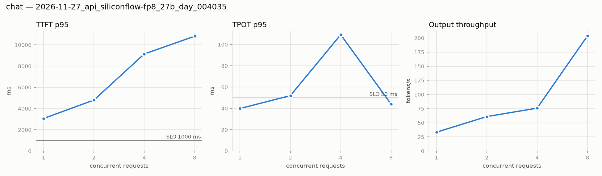
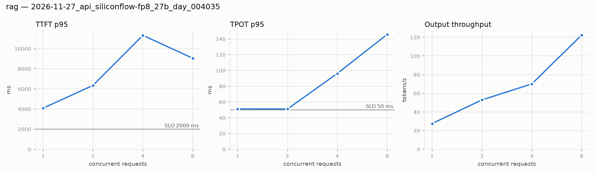

# Benchmark report — 2026-11-27_api_siliconflow-fp8_27b_day_004035

- **GPU:** none (local)
- **Provider / price:** – · price not set (GPU_PRICE_PER_HOUR_USD or --price)
- **Server:** https://openrouter.ai · model `qwen/qwen3.5-27b`
- **Methodology:** – · loadgen 0.1.0 · repo –
- **Prompt calibration:** 1.000 tokens/word (fixed)
- **Run:** 2026-11-27T00:40:36.062Z → 2026-11-27T01:03:48.868Z

## chat

512 → 256 tokens. SLO: TTFT p95 ≤ 1000 ms, TPOT p95 ≤ 50 ms, errors < 0.5%.

**Closed loop**

| Load | n | Errors | TTFT p50 / p95 / p99 (ms) | TPOT p50 / p95 (ms) | ITL p99 (ms) | Output tok/s | Req/s | Goodput req/s | SLO | Notes |
|---|---:|---:|---|---|---:|---:|---:|---:|:-:|---|
| c=1 | 30 | 0.0% | 629 / 3,066 / – | 23.8 / 39.9 | 222.6 | 33 | 0.13 | 0.11 | ✗ | p99 n/a (n=30) |
| c=2 | 31 | 0.0% | 749 / 4,803 / – | 23.8 / 52.1 | 258.3 | 61 | 0.25 | 0.17 | ✗ | p99 n/a (n=31) |
| c=4 | 33 | 0.0% | 678 / 9,145 / – | 26.5 / 109.3 | 949.0 | 76 | 0.33 | 0.20 | ✗ | p99 n/a (n=33) |
| c=8 | 49 | 0.0% | 689 / 10,816 / – | 27.3 / 44.1 | 266.2 | 204 | 0.81 | 0.66 | ✗ | p99 n/a (n=49) |

- **Capacity (concurrency):** – concurrent requests · – output tok/s · $– per 1M output tokens · $– per 1M total tokens

## rag

4000 → 300 tokens. SLO: TTFT p95 ≤ 2000 ms, TPOT p95 ≤ 50 ms, errors < 0.5%.

**Closed loop**

| Load | n | Errors | TTFT p50 / p95 / p99 (ms) | TPOT p50 / p95 (ms) | ITL p99 (ms) | Output tok/s | Req/s | Goodput req/s | SLO | Notes |
|---|---:|---:|---|---|---:|---:|---:|---:|:-:|---|
| c=1 | 30 | 0.0% | 1,359 / 4,094 / – | 27.8 / 51.3 | 277.2 | 28 | 0.09 | 0.08 | ✗ | p99 n/a (n=30) |
| c=2 | 31 | 0.0% | 1,425 / 6,352 / – | 27.3 / 51.2 | 266.4 | 53 | 0.18 | 0.13 | ✗ | p99 n/a (n=31) |
| c=4 | 33 | 0.0% | 1,898 / 11,327 / – | 40.0 / 96.2 | 899.9 | 70 | 0.24 | 0.08 | ✗ | p99 n/a (n=33) |
| c=8 | 37 | 0.0% | 1,928 / 9,054 / – | 43.3 / 145.8 | 1,082.9 | 122 | 0.44 | 0.13 | ✗ | p99 n/a (n=37) |

- **Capacity (concurrency):** – concurrent requests · – output tok/s · $– per 1M output tokens · $– per 1M total tokens

Cost assumes the GPU is fully used at the capacity point; setup and idle time are excluded (methodology §6). p99 is shown only with ≥ 300 samples; points where the load generator was the bottleneck are marked invalid and excluded from capacity.
