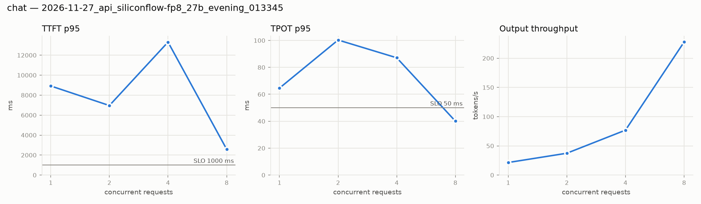
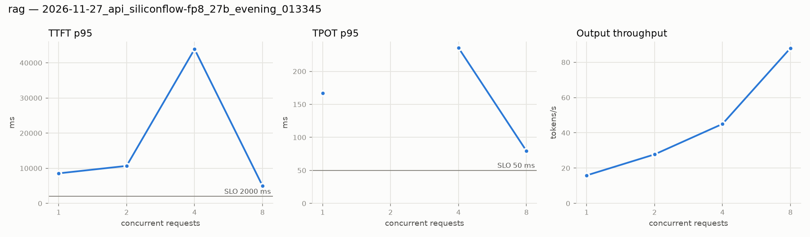

# Benchmark report — 2026-11-27_api_siliconflow-fp8_27b_evening_013345

- **GPU:** none (local)
- **Provider / price:** – · price not set (GPU_PRICE_PER_HOUR_USD or --price)
- **Server:** https://openrouter.ai · model `qwen/qwen3.5-27b`
- **Methodology:** – · loadgen 0.1.0 · repo –
- **Prompt calibration:** 1.000 tokens/word (fixed)
- **Run:** 2026-11-27T01:33:46.126Z → 2026-11-27T02:14:00.706Z

## chat

512 → 256 tokens. SLO: TTFT p95 ≤ 1000 ms, TPOT p95 ≤ 50 ms, errors < 0.5%.

**Closed loop**

| Load | n | Errors | TTFT p50 / p95 / p99 (ms) | TPOT p50 / p95 (ms) | ITL p99 (ms) | Output tok/s | Req/s | Goodput req/s | SLO | Notes |
|---|---:|---:|---|---|---:|---:|---:|---:|:-:|---|
| c=1 | 30 | 0.0% | 688 / 8,919 / – | 33.2 / 64.6 | 820.0 | 21 | 0.08 | 0.04 | ✗ | p99 n/a (n=30) |
| c=2 | 31 | 0.0% | 739 / 6,960 / – | 36.7 / 100.3 | 1,043.9 | 37 | 0.15 | 0.07 | ✗ | p99 n/a (n=31) |
| c=4 | 33 | 0.0% | 632 / 13,312 / – | 39.3 / 87.1 | 1,044.8 | 77 | 0.31 | 0.19 | ✗ | p99 n/a (n=33) |
| c=8 | 56 | 0.0% | 654 / 2,583 / – | 28.2 / 40.1 | 254.0 | 228 | 0.95 | 0.76 | ✗ | p99 n/a (n=56) |

- **Capacity (concurrency):** – concurrent requests · – output tok/s · $– per 1M output tokens · $– per 1M total tokens

## rag

4000 → 300 tokens. SLO: TTFT p95 ≤ 2000 ms, TPOT p95 ≤ 50 ms, errors < 0.5%.

**Closed loop**

| Load | n | Errors | TTFT p50 / p95 / p99 (ms) | TPOT p50 / p95 (ms) | ITL p99 (ms) | Output tok/s | Req/s | Goodput req/s | SLO | Notes |
|---|---:|---:|---|---|---:|---:|---:|---:|:-:|---|
| c=1 | 30 | 0.0% | 1,649 / 8,547 / – | 31.1 / 167.0 | 1,124.0 | 16 | 0.05 | 0.03 | ✗ | p99 n/a (n=30) |
| c=2 | 31 | 3.2% | 1,805 / 10,669 / – | – / – | 1,091.3 | 28 | 0.10 | 0.06 | ✗ | p99 n/a (n=31); http_502 |
| c=4 | 33 | 0.0% | 1,682 / 43,901 / – | 37.7 / 235.5 | 1,149.4 | 45 | 0.16 | 0.08 | ✗ | p99 n/a (n=33) |
| c=8 | 37 | 0.0% | 1,864 / 4,993 / – | 35.2 / 79.4 | 800.7 | 88 | 0.28 | 0.11 | ✗ | p99 n/a (n=37) |

- **Capacity (concurrency):** – concurrent requests · – output tok/s · $– per 1M output tokens · $– per 1M total tokens

Cost assumes the GPU is fully used at the capacity point; setup and idle time are excluded (methodology §6). p99 is shown only with ≥ 300 samples; points where the load generator was the bottleneck are marked invalid and excluded from capacity.
