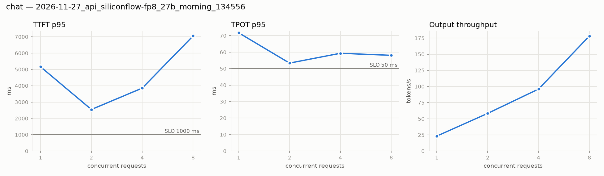
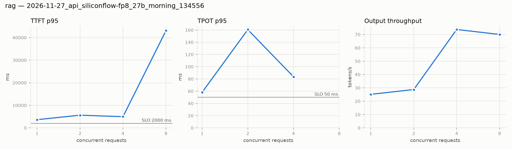

# Benchmark report — 2026-11-27_api_siliconflow-fp8_27b_morning_134556

- **GPU:** none (local)
- **Provider / price:** – · price not set (GPU_PRICE_PER_HOUR_USD or --price)
- **Server:** https://openrouter.ai · model `qwen/qwen3.5-27b`
- **Methodology:** – · loadgen 0.1.0 · repo –
- **Prompt calibration:** 1.000 tokens/word (fixed)
- **Run:** 2026-11-27T13:45:58.086Z → 2026-11-27T14:16:18.930Z

## chat

512 → 256 tokens. SLO: TTFT p95 ≤ 1000 ms, TPOT p95 ≤ 50 ms, errors < 0.5%.

**Closed loop**

| Load | n | Errors | TTFT p50 / p95 / p99 (ms) | TPOT p50 / p95 (ms) | ITL p99 (ms) | Output tok/s | Req/s | Goodput req/s | SLO | Notes |
|---|---:|---:|---|---|---:|---:|---:|---:|:-:|---|
| c=1 | 30 | 0.0% | 642 / 5,163 / – | 26.6 / 71.7 | 675.5 | 23 | 0.09 | 0.06 | ✗ | p99 n/a (n=30) |
| c=2 | 31 | 0.0% | 672 / 2,546 / – | 25.1 / 53.4 | 269.2 | 58 | 0.23 | 0.17 | ✗ | p99 n/a (n=31) |
| c=4 | 33 | 0.0% | 674 / 3,856 / – | 31.4 / 59.3 | 563.6 | 96 | 0.39 | 0.23 | ✗ | p99 n/a (n=33) |
| c=8 | 42 | 0.0% | 706 / 7,052 / – | 30.5 / 58.1 | 539.5 | 178 | 0.71 | 0.41 | ✗ | p99 n/a (n=42) |

- **Capacity (concurrency):** – concurrent requests · – output tok/s · $– per 1M output tokens · $– per 1M total tokens

## rag

4000 → 300 tokens. SLO: TTFT p95 ≤ 2000 ms, TPOT p95 ≤ 50 ms, errors < 0.5%.

**Closed loop**

| Load | n | Errors | TTFT p50 / p95 / p99 (ms) | TPOT p50 / p95 (ms) | ITL p99 (ms) | Output tok/s | Req/s | Goodput req/s | SLO | Notes |
|---|---:|---:|---|---|---:|---:|---:|---:|:-:|---|
| c=1 | 30 | 0.0% | 1,547 / 3,632 / – | 26.2 / 58.1 | 389.5 | 25 | 0.08 | 0.05 | ✗ | p99 n/a (n=30) |
| c=2 | 31 | 0.0% | 1,757 / 5,627 / – | 47.2 / 160.6 | 1,112.7 | 29 | 0.10 | 0.03 | ✗ | p99 n/a (n=31) |
| c=4 | 33 | 0.0% | 1,533 / 4,959 / – | 39.2 / 83.6 | 743.2 | 74 | 0.25 | 0.12 | ✗ | p99 n/a (n=33) |
| c=8 | 37 | 2.7% | 2,564 / 43,070 / – | – / – | 1,214.6 | 70 | 0.25 | 0.12 | ✗ | p99 n/a (n=37); http_502 |

- **Capacity (concurrency):** – concurrent requests · – output tok/s · $– per 1M output tokens · $– per 1M total tokens

Cost assumes the GPU is fully used at the capacity point; setup and idle time are excluded (methodology §6). p99 is shown only with ≥ 300 samples; points where the load generator was the bottleneck are marked invalid and excluded from capacity.
