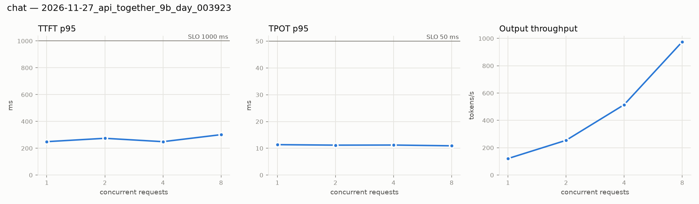
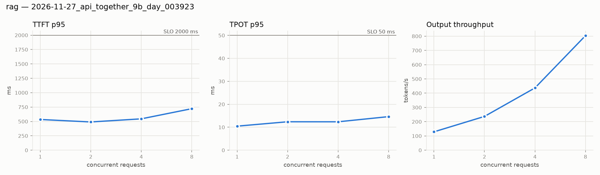

# Benchmark report — 2026-11-27_api_together_9b_day_003923

- **GPU:** none (local)
- **Provider / price:** – · price not set (GPU_PRICE_PER_HOUR_USD or --price)
- **Server:** https://openrouter.ai · model `qwen/qwen3.5-9b`
- **Methodology:** – · loadgen 0.1.0 · repo –
- **Prompt calibration:** 1.000 tokens/word (fixed)
- **Run:** 2026-11-27T00:39:23.675Z → 2026-11-27T00:46:34.828Z

## chat

512 → 256 tokens. SLO: TTFT p95 ≤ 1000 ms, TPOT p95 ≤ 50 ms, errors < 0.5%.

**Closed loop**

| Load | n | Errors | TTFT p50 / p95 / p99 (ms) | TPOT p50 / p95 (ms) | ITL p99 (ms) | Output tok/s | Req/s | Goodput req/s | SLO | Notes |
|---|---:|---:|---|---|---:|---:|---:|---:|:-:|---|
| c=1 | 30 | 0.0% | 208 / 249 / – | 5.8 / 11.4 | 56.0 | 121 | 0.49 | 0.49 | ✓ | p99 n/a (n=30) |
| c=2 | 60 | 0.0% | 212 / 274 / – | 5.7 / 11.2 | 58.3 | 254 | 1.00 | 0.98 | ✓ | p99 n/a (n=60) |
| c=4 | 63 | 0.0% | 217 / 249 / – | 5.8 / 11.2 | 53.2 | 515 | 2.03 | 2.03 | ✓ | p99 n/a (n=63) |
| c=8 | 67 | 0.0% | 225 / 301 / – | 6.3 / 10.9 | 58.3 | 976 | 3.75 | 3.70 | ✓ | p99 n/a (n=67) |

- **Capacity (concurrency):** 8 concurrent requests · 976 output tok/s · $– per 1M output tokens · $– per 1M total tokens

## rag

4000 → 300 tokens. SLO: TTFT p95 ≤ 2000 ms, TPOT p95 ≤ 50 ms, errors < 0.5%.

**Closed loop**

| Load | n | Errors | TTFT p50 / p95 / p99 (ms) | TPOT p50 / p95 (ms) | ITL p99 (ms) | Output tok/s | Req/s | Goodput req/s | SLO | Notes |
|---|---:|---:|---|---|---:|---:|---:|---:|:-:|---|
| c=1 | 30 | 0.0% | 326 / 534 / – | 5.6 / 10.5 | 49.4 | 129 | 0.44 | 0.44 | ✓ | p99 n/a (n=30) |
| c=2 | 48 | 0.0% | 289 / 491 / – | 6.7 / 12.4 | 56.9 | 237 | 0.81 | 0.81 | ✓ | p99 n/a (n=48) |
| c=4 | 63 | 0.0% | 288 / 545 / – | 7.3 / 12.4 | 65.2 | 437 | 1.47 | 1.47 | ✓ | p99 n/a (n=63) |
| c=8 | 67 | 0.0% | 421 / 722 / – | 7.2 / 14.6 | 77.7 | 804 | 2.72 | 2.72 | ✓ | p99 n/a (n=67) |

- **Capacity (concurrency):** 8 concurrent requests · 804 output tok/s · $– per 1M output tokens · $– per 1M total tokens

Cost assumes the GPU is fully used at the capacity point; setup and idle time are excluded (methodology §6). p99 is shown only with ≥ 300 samples; points where the load generator was the bottleneck are marked invalid and excluded from capacity.
