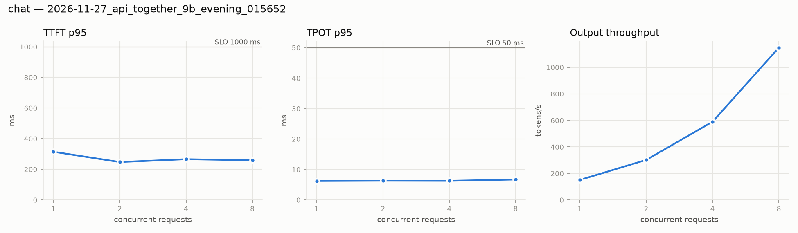
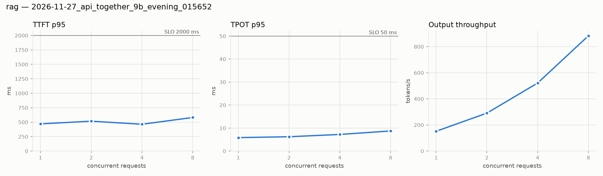

# Benchmark report — 2026-11-27_api_together_9b_evening_015652

- **GPU:** none (local)
- **Provider / price:** – · price not set (GPU_PRICE_PER_HOUR_USD or --price)
- **Server:** https://openrouter.ai · model `qwen/qwen3.5-9b`
- **Methodology:** – · loadgen 0.1.0 · repo –
- **Prompt calibration:** 1.000 tokens/word (fixed)
- **Run:** 2026-11-27T01:56:52.848Z → 2026-11-27T02:03:18.690Z

## chat

512 → 256 tokens. SLO: TTFT p95 ≤ 1000 ms, TPOT p95 ≤ 50 ms, errors < 0.5%.

**Closed loop**

| Load | n | Errors | TTFT p50 / p95 / p99 (ms) | TPOT p50 / p95 (ms) | ITL p99 (ms) | Output tok/s | Req/s | Goodput req/s | SLO | Notes |
|---|---:|---:|---|---|---:|---:|---:|---:|:-:|---|
| c=1 | 36 | 0.0% | 209 / 315 / – | 5.7 / 6.2 | 41.8 | 151 | 0.59 | 0.59 | ✓ | p99 n/a (n=36) |
| c=2 | 61 | 0.0% | 210 / 248 / – | 6.0 / 6.3 | 46.4 | 302 | 1.20 | 1.20 | ✓ | p99 n/a (n=61) |
| c=4 | 63 | 0.0% | 216 / 266 / – | 5.9 / 6.3 | 49.1 | 590 | 2.29 | 2.26 | ✓ | p99 n/a (n=63) |
| c=8 | 67 | 0.0% | 221 / 259 / – | 6.2 / 6.7 | 52.8 | 1,149 | 4.50 | 4.50 | ✓ | p99 n/a (n=67) |

- **Capacity (concurrency):** 8 concurrent requests · 1,149 output tok/s · $– per 1M output tokens · $– per 1M total tokens

## rag

4000 → 300 tokens. SLO: TTFT p95 ≤ 2000 ms, TPOT p95 ≤ 50 ms, errors < 0.5%.

**Closed loop**

| Load | n | Errors | TTFT p50 / p95 / p99 (ms) | TPOT p50 / p95 (ms) | ITL p99 (ms) | Output tok/s | Req/s | Goodput req/s | SLO | Notes |
|---|---:|---:|---|---|---:|---:|---:|---:|:-:|---|
| c=1 | 31 | 0.0% | 293 / 470 / – | 5.5 / 5.8 | 37.3 | 151 | 0.52 | 0.52 | ✓ | p99 n/a (n=31) |
| c=2 | 58 | 0.0% | 309 / 517 / – | 5.8 / 6.2 | 43.9 | 291 | 1.00 | 1.00 | ✓ | p99 n/a (n=58) |
| c=4 | 63 | 0.0% | 339 / 463 / – | 6.6 / 7.2 | 55.1 | 521 | 1.75 | 1.75 | ✓ | p99 n/a (n=63) |
| c=8 | 67 | 0.0% | 345 / 581 / – | 7.8 / 8.7 | 78.2 | 883 | 3.08 | 3.08 | ✓ | p99 n/a (n=67) |

- **Capacity (concurrency):** 8 concurrent requests · 883 output tok/s · $– per 1M output tokens · $– per 1M total tokens

Cost assumes the GPU is fully used at the capacity point; setup and idle time are excluded (methodology §6). p99 is shown only with ≥ 300 samples; points where the load generator was the bottleneck are marked invalid and excluded from capacity.
