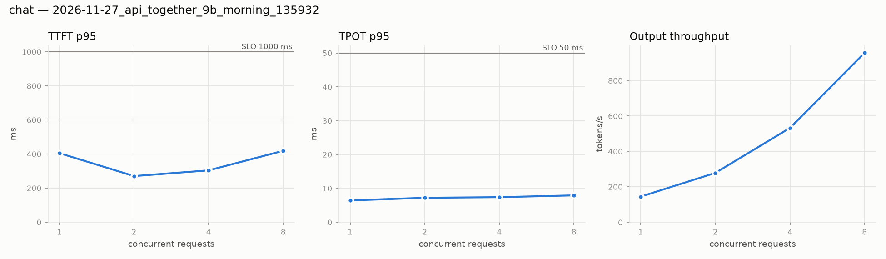
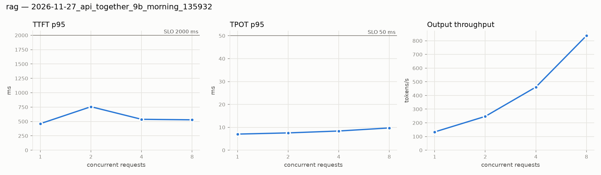

# Benchmark report — 2026-11-27_api_together_9b_morning_135932

- **GPU:** none (local)
- **Provider / price:** – · price not set (GPU_PRICE_PER_HOUR_USD or --price)
- **Server:** https://openrouter.ai · model `qwen/qwen3.5-9b`
- **Methodology:** – · loadgen 0.1.0 · repo –
- **Prompt calibration:** 1.000 tokens/word (fixed)
- **Run:** 2026-11-27T13:59:32.404Z → 2026-11-27T14:06:27.601Z

## chat

512 → 256 tokens. SLO: TTFT p95 ≤ 1000 ms, TPOT p95 ≤ 50 ms, errors < 0.5%.

**Closed loop**

| Load | n | Errors | TTFT p50 / p95 / p99 (ms) | TPOT p50 / p95 (ms) | ITL p99 (ms) | Output tok/s | Req/s | Goodput req/s | SLO | Notes |
|---|---:|---:|---|---|---:|---:|---:|---:|:-:|---|
| c=1 | 34 | 0.0% | 228 / 405 / – | 5.9 / 6.4 | 40.4 | 145 | 0.58 | 0.57 | ✓ | p99 n/a (n=34) |
| c=2 | 61 | 0.0% | 224 / 271 / – | 6.3 / 7.2 | 47.6 | 279 | 1.10 | 1.10 | ✓ | p99 n/a (n=61) |
| c=4 | 63 | 0.0% | 227 / 304 / – | 6.8 / 7.4 | 53.8 | 533 | 2.03 | 1.97 | ✓ | p99 n/a (n=63) |
| c=8 | 67 | 0.0% | 242 / 419 / – | 7.2 / 7.9 | 58.8 | 957 | 3.89 | 3.71 | ✓ | p99 n/a (n=67) |

- **Capacity (concurrency):** 8 concurrent requests · 957 output tok/s · $– per 1M output tokens · $– per 1M total tokens

## rag

4000 → 300 tokens. SLO: TTFT p95 ≤ 2000 ms, TPOT p95 ≤ 50 ms, errors < 0.5%.

**Closed loop**

| Load | n | Errors | TTFT p50 / p95 / p99 (ms) | TPOT p50 / p95 (ms) | ITL p99 (ms) | Output tok/s | Req/s | Goodput req/s | SLO | Notes |
|---|---:|---:|---|---|---:|---:|---:|---:|:-:|---|
| c=1 | 30 | 0.0% | 310 / 461 / – | 6.7 / 7.0 | 47.4 | 133 | 0.44 | 0.44 | ✓ | p99 n/a (n=30) |
| c=2 | 51 | 0.0% | 300 / 757 / – | 7.3 / 7.6 | 49.4 | 247 | 0.85 | 0.84 | ✓ | p99 n/a (n=51) |
| c=4 | 63 | 0.0% | 359 / 537 / – | 7.6 / 8.4 | 56.8 | 461 | 1.57 | 1.57 | ✓ | p99 n/a (n=63) |
| c=8 | 67 | 0.0% | 305 / 528 / – | 8.9 / 9.7 | 86.4 | 837 | 2.89 | 2.89 | ✓ | p99 n/a (n=67) |

- **Capacity (concurrency):** 8 concurrent requests · 837 output tok/s · $– per 1M output tokens · $– per 1M total tokens

Cost assumes the GPU is fully used at the capacity point; setup and idle time are excluded (methodology §6). p99 is shown only with ≥ 300 samples; points where the load generator was the bottleneck are marked invalid and excluded from capacity.
