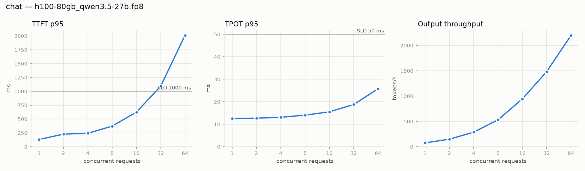

# Benchmark report — h100-80gb_qwen3.5-27b.fp8

- **GPU:** NVIDIA H100 80GB HBM3 · driver 595.112.07 · PCIe gen5 x16
- **Provider / price:** runpod · $4.39/h
- **Server:** http://127.0.0.1:8000 · model `Qwen/Qwen3.5-27B-FP8` · vLLM 0.32.0
- **Methodology:** 1.2 · loadgen 0.1.0 · repo c5c8a9615a
- **Prompt calibration:** 1.000 tokens/word (tokenize)
- **Run:** 2026-11-27T19:30:21.313Z → 2026-11-27T19:55:33.084Z

## chat

512 → 256 tokens. SLO: TTFT p95 ≤ 1000 ms, TPOT p95 ≤ 50 ms, errors < 0.5%.

**Closed loop**

| Load | n | Errors | TTFT p50 / p95 / p99 (ms) | TPOT p50 / p95 (ms) | ITL p99 (ms) | Output tok/s | Req/s | Goodput req/s | SLO | Notes |
|---|---:|---:|---|---|---:|---:|---:|---:|:-:|---|
| c=1 | 30 | 0.0% | 127 / 131 / – | 12.5 / 12.5 | 15.8 | 77 | 0.30 | 0.30 | ✓ | p99 n/a (n=30) |
| c=2 | 54 | 0.0% | 206 / 228 / – | 12.7 / 12.7 | 15.2 | 149 | 0.59 | 0.59 | ✓ | p99 n/a (n=54) |
| c=4 | 101 | 0.0% | 225 / 242 / – | 13.1 / 13.1 | 16.5 | 289 | 1.13 | 1.13 | ✓ | p99 n/a (n=101) |
| c=8 | 189 | 0.0% | 350 / 372 / – | 13.7 / 14.1 | 18.1 | 532 | 2.13 | 2.13 | ✓ | p99 n/a (n=189) |
| c=16 | 315 | 0.0% | 547 / 624 / 634 | 14.8 / 15.5 | 21.5 | 944 | 3.82 | 3.82 | ✓ |  |
| c=32 | 331 | 0.0% | 880 / 1,093 / 1,099 | 17.8 / 18.8 | 25.3 | 1,484 | 5.99 | 3.77 | ✗ |  |
| c=64 | 363 | 0.0% | 1,496 / 2,011 / 2,020 | 22.6 / 25.8 | 46.4 | 2,197 | 9.70 | 2.14 | ✗ |  |

**Open loop (Poisson)**

| Load | n | Errors | TTFT p50 / p95 / p99 (ms) | TPOT p50 / p95 (ms) | ITL p99 (ms) | Output tok/s | Req/s | Goodput req/s | SLO | Notes |
|---|---:|---:|---|---|---:|---:|---:|---:|:-:|---|
| 2.031 req/s | 181 | 0.0% | 141 / 224 / – | 16.6 / 18.1 | 109.9 | 526 | 2.10 | 2.10 | ✓ | p99 n/a (n=181) |
| 4.062 req/s | 300 | 0.0% | 146 / 237 / 283 | 19.7 / 21.6 | 110.7 | 942 | 3.66 | 3.66 | ✓ |  |
| 6.093 req/s | 300 | 0.0% | 175 / 254 / 287 | 25.1 / 27.2 | 110.2 | 1,488 | 5.74 | 5.74 | ✓ |  |
| 7.312 req/s | 300 | 0.0% | 194 / 267 / 292 | 32.4 / 35.2 | 111.0 | 1,928 | 7.50 | 7.50 | ✓ |  |
| 8.124 req/s | 300 | 0.0% | 208 / 280 / 313 | 32.2 / 38.9 | 111.8 | 2,084 | 8.65 | 8.65 | ✓ |  |
| 8.937 req/s | 300 | 0.0% | 212 / 281 / 303 | 43.3 / 45.8 | 118.4 | 2,439 | 9.14 | 9.14 | ✓ |  |
| 10.155 req/s | 300 | 0.0% | 648 / 1,311 / 1,463 | 47.1 / 47.7 | 117.4 | 2,643 | 10.08 | 7.52 | ✗ |  |
| 12.186 req/s | 300 | 0.0% | 9,160 / 11,396 / 11,672 | 46.5 / 47.2 | 114.9 | 2,705 | 10.67 | 0.00 | ✗ |  |

- **Capacity (concurrency):** 16 concurrent requests · 944 output tok/s · $1.292 per 1M output tokens · $0.424 per 1M total tokens
- **Capacity (rate):** 8.94 req/s · 2,439 output tok/s · $0.500 per 1M output tokens · $0.160 per 1M total tokens

Cost assumes the GPU is fully used at the capacity point; setup and idle time are excluded (methodology §6). p99 is shown only with ≥ 300 samples; points where the load generator was the bottleneck are marked invalid and excluded from capacity.
